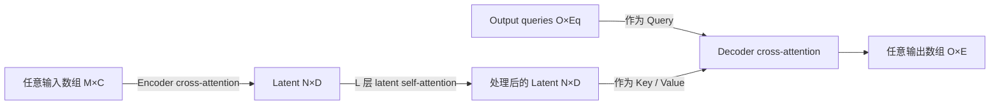

> [!abstract] 摘要（原文翻译）
> 机器学习的一个核心目标，是开发能够在尽可能多的数据领域中解决尽可能多问题的系统。然而，现有架构通常只能适用于少数典型场景，因为它们要么在架构中固化了特定领域与任务的假设，要么在大规模输入或输出上扩展性较差。本文提出 **Perceiver IO**：一种通用架构，可处理任意形式的数据，并使计算量随输入与输出规模线性增长。该模型在 Perceiver 的基础上加入灵活的查询机制，使网络能够生成具有不同尺寸和语义的输出，从而减少针对每个任务单独设计网络结构的需求。相同的架构在自然语言理解、视觉理解、多任务与多模态推理以及 StarCraft II 等任务上都取得了较强结果。代表性结果包括：在去除输入分词的情况下，Perceiver IO 在 GLUE 语言理解基准上超过基于 Transformer 的 BERT 基线；在没有显式多尺度对应机制的情况下，在 Sintel 光流估计上取得当时的先进结果。

## 一句话概括

Perceiver IO 的核心不是“再设计一种 Transformer block”，而是把 **输入、主干计算和输出三者的索引规模解耦**：先用 cross-attention 将任意长输入压入固定数量的 latent，再在 latent 上做深层 self-attention，最后用带有“输出语义”的 query 从 latent 中读出任意数量、任意结构的输出。

## 问题与动机

标准 Transformer 将每个输入 token 同时作为 Query、Key、Value，并在每层都对完整序列做 self-attention，因此长度为 $M$ 的输入在单层中存在约 $\mathcal{O}(M^2)$ 的注意力开销。对于像素、视频体素、原始音频或 byte-level 文本，这种二次复杂度会迅速成为瓶颈。

原始 Perceiver 已经解决了“**任意大、任意模态输入如何进入一个统一网络**”的问题：它用少量 latent 作为 Query，对输入做 cross-attention，将大输入压缩到固定大小的 latent 空间，再在 latent 上反复做 self-attention。但原始 Perceiver 的输出端主要面向分类等简单输出，通常通过平均池化后投影得到一个类别向量，因此仍不能自然处理光流场、序列、音视频重建、集合输出等高维结构化输出。

Perceiver IO 因此进一步追问：**如果输入可以通过 cross-attention 映射到固定 latent，那么能否用对称的方式，再从 latent 映射到任意结构的输出？** 本文的答案是：为每一个期望输出构造一个具有明确语义的 output query，让它对 latent 做 cross-attention。

## 方法

### 1. 总体结构：Read - Process - Write

论文将网络概括为三步：

1. **Read / Encode**：输入数组 $x\in\mathbb{R}^{M\times C}$ 通过 cross-attention 被映射到 latent 数组 $z\in\mathbb{R}^{N\times D}$。
2. **Process**：在固定大小的 latent 数组上堆叠 $L$ 个 self-attention 模块进行深层处理。
3. **Write / Decode**：构造 $O$ 个 output queries，对 latent 做 cross-attention，得到输出数组 $y\in\mathbb{R}^{O\times E}$。

其中：

- $M$：输入元素数，例如字符/byte、像素、视频 patch、实体等；
- $C$：每个输入元素的特征维数；
- $N$：latent 元素数，是人为设定的模型超参数，通常远小于 $M$ 和 $O$；
- $D$：latent channel 宽度；
- $O$：需要生成的输出元素数；
- $E$：每个输出元素的最终特征维数。

> [!note] 与标准 Transformer 的关键差别
> 主干网络的深度计算发生在固定大小的 latent 上，而不是在完整输入或完整输出上。输入和输出的索引规模只在网络首尾各参与一次 cross-attention，因此网络深度不会把大输入/大输出的代价反复乘上去。

### 2. Attention 模块的统一形式

Encoder、Processor、Decoder 都由同一种 Transformer 风格模块构成：**QKV attention + MLP（Multi-Layer Perceptron，多层感知机）**。区别只在 Query 与 Key/Value 来自哪里。

给定 Query 输入 $X_Q\in\mathbb{R}^{N\times D}$ 与 Key/Value 输入 $X_{KV}\in\mathbb{R}^{M\times C}$：

$$
Q=f_Q(X_Q),\qquad K=f_K(X_{KV}),\qquad V=f_V(X_{KV})
$$

$$
A=\operatorname{softmax}\left(\frac{QK^\top}{\sqrt{F}}\right)
$$

$$
\operatorname{Attn}(X_Q,X_{KV})=f_O(AV)
$$

其中 $F$ 是 Q/K/V 投影后的共享特征维度，$A\in\mathbb{R}^{N\times M}$ 是注意力权重矩阵。

完整 block 使用 pre-LayerNorm（预归一化）与残差连接：

$$
H=\operatorname{Attn}(\operatorname{LN}(X_Q),\operatorname{LN}(X_{KV}))
$$

$$
H\leftarrow H+X_Q
$$

$$
H\leftarrow H+\operatorname{MLP}(\operatorname{LN}(H))
$$

论文特别指出：**Decoder 中有时会去掉 $H+X_Q$ 这条残差**。原因是 decoder query 可能包含来自输入空间的特征，例如光流任务中的 RGB 与 Fourier features；若强行把 query 加到输出上，相当于要求网络在这些输入特征的偏置之上再“修正”成目标输出，反而增加学习难度。

### 3. Encode：用 latent queries 压缩任意输入

Encoder 是 cross-attention：

- Query 来自 $N$ 个 latent；
- Key / Value 来自 $M$ 个输入元素；
- 输出索引维度与 Query 相同，因此无论 $M$ 多大，编码后都得到固定的 $N$ 个 latent。

这一步类似“可学习的信息汇聚”：每个 latent 通过注意力从所有输入位置读取自己需要的信息。latent 本身不要求具有图像网格、序列顺序或其他显式空间结构，因此主干网络对输入域的具体几何组织保持相对无关。

### 4. Process：在固定 latent 空间内做深层 self-attention

编码后，Key、Value、Query 全部来自同一个 $N\times D$ latent 数组，因此这一阶段就是标准 self-attention。关键是 $N$ 是固定超参数，深度可以增加而不随原始输入长度同步放大计算量。

语言实验最能体现这一点：在近似 FLOPs（Floating Point Operations，浮点运算量）预算下，Perceiver IO 使用 256 个 latent，将 processor 做到 26 层，而 BERT Base 为 12 层。

### 5. Decode：output query 是“我要什么输出”的显式接口

这是 Perceiver IO 相对原始 Perceiver 最核心的新增机制。

若目标有 $O$ 个输出点，就构造 $O$ 个 query。每个 query 不必是“一个待生成 token”，而是一个描述目标输出语义的向量。它可以由以下信息组成：

| 输出类型 | Query 中包含的信息 | 作用 |
|---|---|---|
| 简单分类 | 单个可学习向量 | 请求一个全局类别输出 |
| 多任务分类 | 每个任务一个 task embedding | 告诉 decoder 当前要读出哪一个任务 |
| 序列 / MLM | 位置 embedding | 指定要预测哪个序列位置 |
| 光流 | 查询位置的输入特征 + 位置特征 | 指定“哪个像素、结合该处观测”要输出二维位移 |
| StarCraft II | 对应 unit/entity 的特征 | 将输出与具体实体绑定 |
| 多模态重建 | 模态 embedding + 1D/3D 位置编码 | 区分音频、视频、标签以及模态内部的位置 |

query 的各部分可以**拼接（concatenate）或相加（add）**。只要这些特征足以区分不同输出的语义，latent processor 会被训练成把信息组织为“容易被这些 query 读取”的形式。

### 6. Decoder 为什么可以并行输出

每个输出点只依赖：

- 自己的 output query；
- 共享的 latent array。

Decoder 中没有要求输出点之间按顺序互相依赖，因此所有输出 query 可以并行 cross-attend latent。这与自回归 Transformer decoder 明显不同：Perceiver IO 在本文任务中主要是**并行结构化解码**，而不是“根据前一个实际输出再预测下一个输出”。

这一性质还允许训练时对超大输出做采样：对于具有约几十万到八十万级输出点的多模态重建，训练时只随机抽取一部分 output queries 计算损失；测试时再分批解码全部输出。

### 7. 计算复杂度

设输入点数为 $M$、latent 数为 $N$、输出点数为 $O$、processor 深度为 $L$、特征宽度统一记为 $F$：

- Encoder cross-attention：$\mathcal{O}(MNF)$；
- $L$ 层 latent self-attention：$\mathcal{O}(LN^2F)$；
- Decoder cross-attention：$\mathcal{O}(ONF)$。

总复杂度为：

$$
\mathcal{O}\big([M+O+LN]NF\big)
$$

因此，当 $N$ 固定时，复杂度对输入长度 $M$ 与输出长度 $O$ 都是线性的；更重要的是，网络加深只增加 $N^2$ 级的 latent 计算，不会在每一层重复承担 $M^2$ 或 $O^2$ 的代价。

## 关键概念补充

> [!info] Fourier feature positional encoding（Fourier 特征位置编码，外部资料补充）
> 注意力本身无法仅凭内容知道一个点处在“第几个位置”或“二维坐标在哪里”。本文在图像、视频、音频等任务中将连续坐标映射为多频率正弦/余弦特征，再与输入特征或 query 拼接。典型形式可写作
> $$
> \gamma(p)=[p,\sin(2\pi f_1p),\cos(2\pi f_1p),\ldots,\sin(2\pi f_Kp),\cos(2\pi f_Kp)].
> $$
> 直观上，低频分量提供粗位置，高频分量让网络更容易区分很近的位置并表示快速空间变化。本文对图像使用 2D、音频使用 1D、视频使用 3D Fourier features；每个维度使用 64 个 sine/cosine frequency bands，坐标缩放到 $[-1,1]$。这一做法与 Tancik 等关于 Fourier features 缓解神经网络高频学习困难的工作相关（arXiv:2006.10739）。

> [!info] LAMB（Layer-wise Adaptive Moments optimizer for Batch training，外部资料补充）
> 本文多项大批量实验采用 LAMB。它可以看作带有 Adam 风格一阶/二阶动量估计的优化器，但还根据“参数范数与归一化更新范数之比”为每层调整实际步长，即引入 layer-wise trust ratio。其目标是让非常大的 batch size 下，不同尺度的层仍能使用相对合适的更新幅度。LAMB 最初就是为大规模 BERT 训练提出的（You et al., arXiv:1904.00962）。

## 实验设置与结果

论文的重点不是针对单一任务做到最优，而是验证：**同一个 Read-Process-Write + query decoder 模板能否跨越语言、视觉、多模态与符号集合任务。**

### 1. 语言：Masked Language Modeling + GLUE

#### 输入与预训练

论文同时测试 SentencePiece token 与原始 UTF-8 byte 输入。

- SentencePiece：序列长度 512；词表 32,000。
- UTF-8 byte：序列长度 2048；词表为 256 个 byte 加 4 个特殊符号 `[PAD]`、`[MASK]`、`[CLS]`、`[SEP]`。
- 预训练语料：70% C4 + 30% English Wikipedia。
- MLM（Masked Language Modeling，掩码语言建模）：按空格划分 word，每个 word 以 15% 概率被 mask。
- 预训练 500,000 step，batch size 2048。
- 优化器 LAMB，learning rate 0.00125，线性 warm-up 1,000 step，之后 cosine decay；weight decay 0.01。

Perceiver IO Base 的关键结构：

- latent 数 $N=256$；
- latent width $D=1280$；
- processor 26 层；
- UTF-8 与 SentencePiece 版本均在相近 FLOPs 预算下与 BERT 比较。

Perceiver IO++：

- $N=256$；
- $D=1536$；
- processor 40 层。

MLM 解码时，每个输入位置对应一个 learned positional query；通过线性层映射到 byte/token logits，使用 softmax cross-entropy 预测被 mask 的原始内容。

#### GLUE fine-tuning

- 训练 10 epoch；
- batch size 在 {16, 32, 64} 中搜索；
- learning rate 在 {$10^{-4}$, $5\times10^{-5}$, $2\times10^{-5}$, $10^{-5}$} 中搜索；
- warm-up 200 step；weight decay 0.01。

单任务分类不依赖 `[CLS]` 输入 token，而是直接用一个 decoder query 请求分类输出。多任务版本则给不同任务分配不同 task query。

#### 结果

| 模型 | 输入 | GLUE 平均分 | 训练 step/s |
|---|---|---:|---:|
| BERT Base（复现） | SentencePiece, 512 | 81.1 | 7.3 |
| Perceiver IO Base | SentencePiece, 512 | 81.2 | 7.4 |
| BERT（匹配 FLOPs） | UTF-8 bytes, 2048 | 71.5 | 2.9 |
| Perceiver IO | UTF-8 bytes, 2048 | 81.0 | 7.6 |
| Perceiver IO++ | UTF-8 bytes, 2048 | **81.8** | 4.2 |

关键现象：byte-level BERT 为了控制 FLOPs 必须显著缩窄/变浅，性能明显下降；Perceiver IO 则能直接处理 2048 bytes，并达到与 SentencePiece BERT 相当甚至更高的分数。

多任务 GLUE 中，task-specific input token 与 multitask query 都达到约 81.8 的平均分；后者不需要把任务信息塞进输入数组，因此输入与输出接口解耦得更彻底。

### 2. 光流 Optical Flow

#### 问题

输入相邻两帧，输出第一帧每个像素对应的二维位移向量。传统强方法通常显式构建 cost volume、warping、多尺度金字塔或迭代更新机制来寻找对应关系。

#### Perceiver IO 设置

主版本几乎没有这些专用结构：

- 将两帧沿 channel 维拼接；
- 对每个像素提取 $3\times3$ 邻域，因此两帧 RGB 合计为 $3\times3\times3\times2=54$ 个数；
- 拼接固定 2D Fourier position encoding；
- decoder query 使用对应位置的输入 encoding；
- latent 数 2048，latent channels 512；
- processor 深度 24；每层 16 个 self-attention heads；
- 在 $368\times496$ 图像上的一次 forward 约 987B FLOPs，约 27.9M 参数。

训练：

- AutoFlow：400,000 对合成图像；
- 480 epoch；
- batch size 512；
- LAMB；初始 learning rate $4\times10^{-4}$，cosine schedule；
- 使用 AutoFlow augmentation curriculum，并加入一段完全关闭 augmentation 的阶段；该阶段还将每对图像正序/反序各放入 batch 一次。

论文还测试了：1×1 patch、分开输入两帧、卷积下采样 + RAFT 风格上采样等变体。

#### 结果：EPE（End-Point Error，端点误差，越低越好）

| 模型 | Sintel.clean | Sintel.final | KITTI |
|---|---:|---:|---:|
| PWCNet | 2.17 | 2.91 | 5.76 |
| RAFT | 1.95 | 2.57 | **4.23** |
| Perceiver IO | **1.81** | **2.42** | 4.98 |

论文强调：Perceiver IO 在不使用 cost volume、显式 warping、显式层级结构，而且 latent 不保留二维网格结构的情况下，仍在 Sintel 上超过所比较的 RAFT 结果；KITTI 上则弱于 RAFT、强于 PWCNet。

消融还显示：两帧沿 channel 拼接对更困难的 Sintel.final 与 KITTI 明显有利；更大的局部 spatial context 也有帮助。卷积下采样 + RAFT 上采样能够大幅降低代价，但总体精度略低于全分辨率版本。

### 3. 多模态自编码：Video + Audio + Label

任务是在同一个 bottleneck 中同时重建视频、原始音频波形和类别标签。

#### 输入组织

- 视频：16 帧，$224\times224$；patch 大小 $1\times4\times4$；
- 音频：48 kHz，按每 16 个 sample 组成一个 patch；
- 标签：700 维 one-hot；
- 三种模态被序列化为同一个二维 input array。

每个输入元素除了自身内容，还包含：

- 视频：3D Fourier position encoding + learned video modality embedding；
- 音频：1D Fourier position encoding + learned audio modality embedding；
- 标签：learned label modality embedding。

所有输入最终 padding 到 704 维。

Decoder query：

- 视频 query：3D Fourier position features + video modality embedding；
- 音频 query：1D Fourier position features + audio modality embedding；
- 标签 query：learned query + label modality embedding；
- 最终统一为 1026 维 query。

#### latent 与训练

- latent channels：512；
- latent 数分别为 784 / 392 / 196，对应 88× / 176× / 352× 压缩；
- batch size 1024；learning rate $10^{-3}$；
- loss = 视频 L1 + 音频 L1 + 标签 cross-entropy 的加权和；主设置权重为 0.03 / 1 / 0.0001。

完整输出规模约为几十万到八十万级，训练时不会解码全部位置，而是每个样本只抽取 512 个 audio 输出、512 个 pixel 输出和 label 计算 loss；测试时再分批得到完整输出。

训练时有 50% 概率 mask 掉分类标签，以避免模型简单地把标签直接拷贝进 latent。

#### 结果

| 压缩率 | Audio PSNR | Video PSNR | Top-1 |
|---:|---:|---:|---:|
| 88× | **26.97** | **24.37** | 10.2% |
| 176× | 25.33 | 24.27 | 8.6% |
| 352× | 14.15 | 23.21 | 11.5% |

PSNR（Peak Signal-to-Noise Ratio，峰值信噪比）越高表示重建误差越小。改变 loss 权重、显著提高分类损失权重后，Top-1 可以达到 45%，同时保持 20.7 的视频 PSNR，说明共享 latent 可以在不同模态目标之间重新分配容量，但各任务之间存在明显 trade-off。

### 4. ImageNet：分类 decoder 与输入先验

论文用该任务验证两个问题：query-based decoder 是否优于原 Perceiver 的 average + projection，以及是否必须给模型显式二维图像结构。

主要输入版本：

1. 原始 RGB + 2D Fourier features；
2. RGB 先线性投影，再使用完全 learned positional embedding——不给网络任何显式二维结构；
3. 简单 2D convolution + maxpool，再加 2D Fourier features。

从头训练设置：

- 110 epoch；batch size 1024；64 TPU；
- LAMB；learning rate $2\times10^{-3}$ 前 55 epoch 保持不变，后 55 epoch cosine decay 到 0；
- weight decay 0.1；global gradient norm clip 10；无 dropout；
- 使用 RandAugment、CutMix、MixUp；
- latent processor 使用 8 个 block，每个 block 6 个 attention modules，并在对应 block 间共享权重；只使用一次 encoder cross-attention。

JFT 大规模预训练设置：

- 约 3 亿图像、约 18,000 类；
- 14 epoch；batch size 8192；256 TPU；
- base learning rate $3\times10^{-4}$ + cosine decay；
- 不做 latent depth weight sharing，使用 16 层 latent network。

关键结果：

- 2D Fourier、无预训练：Perceiver IO 79.0% Top-1；
- learned position、完全不给二维先验：72.7%；
- conv + maxpool：82.1%；
- JFT 预训练、无 2D convolution：84.5%；
- JFT 预训练 + conv：86.4%。

这说明架构确实能在极弱图像先验下工作，但简单卷积预处理仍能带来明显效率和性能增益。

### 5. StarCraft II：替换 AlphaStar entity Transformer

AlphaStar 的 entity encoder 输入最多 512 个无序实体，每个实体含类型、位置、生命值等特征。原系统使用 3 层 vanilla Transformer。

论文直接将它替换为：

- 3 层 Perceiver IO；
- 输入与输出仍保持 512 entities；
- latent index dimension 只设为 32；
- 只粗略尝试了 latent 数 32 和 64，没有大规模调参。

| Entity encoder | Win rate | Params | FLOPs |
|---|---:|---:|---:|
| Transformer | 87% | 144M | 3.3B |
| Perceiver IO | 87% | 140M | **0.93B** |

说明它可以作为符号集合处理 Transformer 的近似 drop-in replacement，在保持行为克隆阶段胜率的同时将该模块 FLOPs 降到约原来的 28%。

### 6. AudioSet：多模态分类

数据集包含约 170 万个 10 秒音视频样本，每个样本可对应 527 类中的多个标签。

设置：

- 训练 100 epoch；
- 训练时使用 32-frame clip；测试时使用 16 个有重叠的 32-frame clips；
- 12 个 latent processor modules；$N=512$；
- latent channels 在 512/1024 中搜索；
- 比较 raw audio + video 与 mel-spectrogram + video 两种输入。

结果（mAP，mean Average Precision，平均精度均值，越高越好）：

- raw audio + video：原 Perceiver 42.4，Perceiver IO 43.3；
- mel-spectrogram + video：原 Perceiver 43.6，Perceiver IO **44.9**。

这组实验的作用主要不是刷新榜单，而是表明：即便只做分类，query-based attention decoder 也比原先简单的 average + projection decoder 稳定更强。

## 关键贡献

1. **把 Perceiver 从“通用输入编码器”扩展为“通用输入-输出架构”**：输出不再限定为全局分类，而可以是序列、图像场、音视频波形、集合或多个异构任务。
2. **提出 output query 作为统一输出接口**：query 中显式编码位置、任务、模态或实体语义；Decoder 只需对 latent 做同一种 cross-attention。
3. **输入/输出规模与主干深度解耦**：对输入和输出长度线性扩展，深层计算只发生在固定 latent 上。
4. **训练超大结构化输出时可 query subsampling**：由于各输出点可独立查询 latent，训练可只对少量输出点计算损失，测试再批量完整解码。
5. **跨域验证“同一架构模板”**：语言、光流、图像、多模态自编码、音视频分类、StarCraft 实体集合均使用同一基本 Read-Process-Write 模板，只改变输入特征化和 output query 的语义构造。

## 局限与启发

### 局限

1. **线性并不等于便宜**：当输出有几十万甚至更多位置时，$O\times N$ 的 decoder cross-attention 仍然很大，因此多模态自编码必须训练时只采样输出 query，并在测试时分批解码。
2. **输入端仍要求一次性编码全部输入元素**：论文在多模态自编码附录明确指出，虽然输出可以分批 decode，所有 input points 仍需同时进入 encoder；对超过百万级原始视频/音频点，这是当前瓶颈之一。
3. **减少领域先验并不总是最优效率选择**：ImageNet 上简单 convolution + maxpool 会提高性能并降低部分计算；说明“通用架构”与“利用已知结构的 inductive bias”并不矛盾。
4. **任务之间共享 latent 会产生容量竞争**：多模态重建中，视频、音频、分类的损失权重会明显改变各自质量，说明统一 latent 并不会自动给各模态分配最佳容量。
5. **光流的跨域失败模式仍与训练分布有关**：只在合成 AutoFlow 上训练时，真实视频里的阴影可能被误判为物体运动，压缩伪影也可能导致虚假光流。
6. **对输入尺寸没有天然 shape invariance**：光流评测遇到不同分辨率时采用 tiled inference；作者将使模型对输入 shape 更稳健留作未来工作。
7. **本文的 Decoder 不是通用自回归生成器**：论文实验中的结构化输出主要依靠并行 query 解码，输出之间不直接进行 decoder self-attention；若任务要求强顺序依赖，需要额外设计自回归机制或把历史输出显式纳入 query/输入。

### 启发

- **把“输出坐标/工况/任务身份”当成 Query，而不是硬塞进主干特征**，可以形成非常干净的条件化输出接口。
- 当输入/输出非常大但真正需要高容量全局交互的“信息槽位”不多时，**固定 latent bottleneck** 能把模型深度从数据分辨率中解耦出来。
- 对 dense prediction，可将 query 看成“连续输出域中的采样点”：训练阶段只采样部分位置，推理再查询完整位置，是一种自然的稀疏监督/稀疏解码策略。
- “通用”不意味着拒绝 inductive bias。Perceiver IO 更适合把卷积、patching、物理特征等视为**可选的前后处理模块**，而不是把它们写死进主干网络。

## 关联：3 条核心文献脉络

### 1. Transformer → Perceiver IO：保留 attention 原语，改变计算发生的位置

**Vaswani et al., _Attention Is All You Need_** 提供了 QKV attention、multi-head attention、position-wise feed-forward network 等基础部件。Perceiver IO 没有抛弃这些部件，而是改变它们的拓扑：标准 Transformer 主要在原始序列上反复 self-attend；Perceiver IO 则用两次 cross-attention 把大规模 I/O 接到一个较小 latent Transformer 上。

核心关系：**模块相似，数组流向不同；计算复杂度也因此发生根本变化。**

### 2. Set Transformer → Perceiver IO：learned bottleneck / learned output seed 的先行思路

**Lee et al., _Set Transformer_** 使用 inducing points 在集合中构造注意力瓶颈，并使用 learned seed vectors 通过 multi-head attention pooling 生成输出。论文明确将其视为相关思路之一。

区别在于：Set Transformer 的目标主要是 permutation-invariant set modeling，而 Perceiver 系列更强调把深层计算放在固定 latent 中，并把输入域、输出域与主干网络规模统一解耦。Perceiver IO 的 output query 也比固定 pooling seed 更一般，因为 query 可以携带位置、任务、模态和输入局部特征。

### 3. Perceiver → Perceiver IO：同一作者团队从“通用感知”推进到“通用 I/O”

**Jaegle et al., _Perceiver: General Perception with Iterative Attention_** 是最直接前身。原 Perceiver 已经使用 learned latent 对任意大输入做 cross-attention，再在 latent 上做深层 self-attention，从而解决输入侧的扩展问题。

Perceiver IO 保留这条 encoder + latent processor 主线，关键增量是：

- 用 query-based cross-attention decoder 替代简单的 average/pooling 输出；
- 每个 query 显式指定要读取的输出语义；
- 因此从单一分类自然扩展到 dense、sequence、multitask、multimodal、set-valued outputs。

可以把两篇工作的关系概括为：

> **Perceiver：任意输入 → 固定 latent → 简单输出**  
> **Perceiver IO：任意输入 → 固定 latent → 任意 query-defined 输出**

## 阅读时最值得抓住的三个细节

1. **Latent 不是降采样后的图像网格。** 它没有被规定与输入位置一一对应；空间/序列信息主要由输入位置特征和输出 query 来提供。
2. **Output query 决定输出索引维度。** 想输出 1 个类别就给 1 个 query，想输出每个像素的光流就给每个像素一个 query，想同时做 8 个任务就给 8 个 task queries。
3. **深度主要花在 $N$ 个 latent 上。** 这才是 Perceiver IO 相比“每层都在完整 token/pixel 序列上做 attention”的 Transformer 最重要的结构差异。
