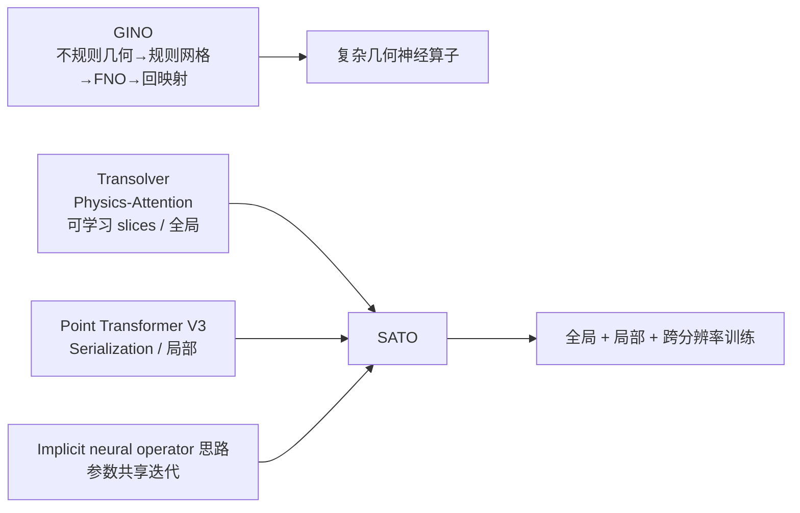

> [!abstract] 摘要
> 汽车工业需要快速评估复杂三维车辆几何的表面压力，但传统 CFD 计算昂贵，而已有数据驱动代理模型往往难以同时建模非结构点云上的全局几何关系与细粒度局部结构。本文提出 **Spatially-Aware Transformer Operator（SATO，空间感知 Transformer 算子）**：一方面用 **physics-attention（物理注意力）** 将大量表面点软聚合为少量具有物理/几何相似性的 slice token，再在 token 间执行注意力以建模全局、大尺度关系；另一方面用 **serialized-attention（序列化注意力）** 通过空间填充曲线把无序三维点云映射为一维序列，在局部 patch 内执行注意力，以捕捉后视镜、门把手、车轮等小尺度结构。两条机制在 SATO layer 中串联并融合，使复杂度对点数近似线性。实验覆盖低保真 ShapeNet Car 与高保真 DrivAerNet：ShapeNet Car 上 SATO 的相对 $L_2$ 误差为 0.0584，相比带隐式迭代的 Transolver 的 0.0672 下降约 13%；DrivAerNet 全分辨率训练时为 0.158，而采用 10% 随机下采样训练、全分辨率推理时进一步降至 0.149，相比 Transolver 的 0.168 下降约 11%。高保真车辆约有 42 万表面点，单车推理仍低于 1 秒。论文的核心结论是：**全局 slice 级物理注意力负责宏观结构，序列化局部注意力负责尖锐/小尺度结构，两者互补；再配合随机下采样与膨胀 patch，可以在显著降低训练资源的同时提升局部预测精度。**

## 1. 问题与动机

### 1.1 任务定义

论文关注稳态车辆外流的**表面压力场代理建模**。在固定自由来流条件下，输入是车辆表面几何 $S$，以点云形式表示；输出是同一表面上的 Reynolds-averaged pressure（雷诺平均压力）：

$$
\mathcal{F}: S \mapsto \bar p\big|_S.
$$

车辆外流通常用 Reynolds-Averaged Navier-Stokes（RANS，雷诺平均 Navier-Stokes）方程求解；传统 CFD 需要生成体网格并在整个流体域中迭代求解，而代理网络只从表面点云直接预测表面压力，因此推理阶段不需要体网格和完整流场求解。

### 1.2 为什么现有方法不够

论文将已有方法的不足概括为：

- **降维/参数化方法**：高效且可解释，但依赖人工几何参数化，难覆盖任意复杂车辆。
- **CNN 方法**：适合规则网格，但复杂三维几何需要 SDF（Signed Distance Field，有符号距离场）或其他规则化表示，可能引入几何失真与额外插值误差。
- **PointNet 类方法**：可直接处理点云，但局部几何与拓扑关系建模能力有限。
- **Neural Operator（神经算子）**：可学习函数空间到函数空间的映射并具有网格无关潜力，但复杂、非规则几何仍然困难。
- **Transformer 类算子**：全局依赖建模能力强，但直接全局 self-attention（自注意力）复杂度为 $O(N^2)$；即使采用压缩型全局注意力，也容易弱化细粒度局部结构。

汽车表面压力同时受到**大尺度车身形状**与**小尺度尖锐结构**影响，因此作者把问题归结为一个多尺度空间相关性建模问题。

## 2. 核心方法

### 2.1 整体结构

论文中图 5 给出 SATO 的主体结构：坐标先经 point-wise linear layer（逐点线性层）编码到高维特征，然后经过若干 SATO layers，最后由线性输出层逐点预测压力。

```mermaid
flowchart TD
    A[表面点坐标 g: N×3] --> B[逐点线性编码]
    B --> C[x^(0): N×C]
    C --> D[SATO Layer × T]
    D --> E[x^(T): N×C]
    E --> F[逐点线性输出]
    F --> G[表面压力 p: N×1]

    subgraph L[单个 SATO Layer]
      P1[LayerNorm] --> PA[Physics-Attention\n全局/大尺度]
      PA --> SUB[与层输入作差]
      SUB --> P2[LayerNorm]
      P2 --> SA[Serialized-Attention\n局部/小尺度]
      PA --> SUM[融合]
      SA --> SUM
      SUM --> P3[LayerNorm]
      P3 --> FFN[FeedForward]
    end
```

> [!note] 图示说明
> 上述 Mermaid 图是根据论文中图 5 的结构关系重绘的文字化示意，并非论文原图。当前笔记包未裁切原论文图片。

### 2.2 Physics-attention：用可学习 slice 建模全局结构

Physics-attention 直接继承自 Transolver。核心不是在全部 $N$ 个点之间做注意力，而是先把点软聚合为 $M$ 个 slice，再只在 $M$ 个 slice token 之间交互，其中 $M\ll N$。

#### 第一步：学习每个点属于各 slice 的软权重

对第 $i$ 个点的高维特征 $\mathbf{x}_i\in\mathbb{R}^{1\times C}$：

$$
\mathbf{w}_i=\operatorname{Softmax}(\operatorname{Linear}(\mathbf{x}_i)),
\qquad
\mathbf{w}_i\in\mathbb{R}^{1\times M},
$$

并满足

$$
\sum_{j=1}^{M}w_{i,j}=1.
$$

这里的 slice 不是预先定义的车身部件，而是网络学习出来的软分组。具有相似高维特征的点会得到相似的 slice 权重。

#### 第二步：从点聚合到 slice token

第 $j$ 个 slice 特征为加权平均：

$$
\mathbf{z}_j=
\frac{\sum_{i=1}^{N}w_{i,j}\mathbf{x}_i}
{\sum_{i=1}^{N}w_{i,j}},
$$

于是得到

$$
\mathbf{z}=\{\mathbf{z}_j\}_{j=1}^{M}\in\mathbb{R}^{M\times C}.
$$

这一步把数十万点压缩为少量“物理感知 token”。论文附录 B 的 slice 可视化显示，每个 slice 往往覆盖车身较大的连续区域，而且边界是模糊的，说明它更偏向**宏观结构聚合**，而不是精确零件分割。

#### 第三步：slice token 之间做标准 self-attention

$$
\mathbf{q},\mathbf{k},\mathbf{v}=\operatorname{Linear}(\mathbf{z}),
$$

$$
\mathbf{z}'=
\operatorname{Softmax}\left(\frac{\mathbf{q}\mathbf{k}^{\mathsf T}}{\sqrt C}\right)\mathbf{v}.
$$

#### 第四步：从 slice 解码回每个点

$$
\mathbf{x}'_i=\sum_{j=1}^{M}w_{i,j}\mathbf{z}'_j.
$$

因此同一组权重 $w_{i,j}$ 同时充当“点 $\rightarrow$ slice”和“slice $\rightarrow$ 点”的桥梁。

#### 复杂度

Physics-attention 的复杂度为：

$$
O(NMC+M^2C),
$$

显著低于标准全局 attention 的 $O(N^2C)$。其代价是：点先被压缩为 slice，细粒度局部邻域信息容易被平均掉。

> [!info] 概念补充：为什么它叫 Physics-attention
> Transolver 的原始思想是让网络根据点的高维“物理状态”而不是只根据欧氏距离进行软分组；在训练过程中，具有相似潜在物理状态的网格点会被分到相近 slice，再在 slice token 上学习长程相互作用。SATO 沿用了这一机制，将其明确定位为**全局/大尺度分支**。这一解释与 Transolver 原论文的定义一致。[^transolver]

### 2.3 Serialization：把无序 3D 点云变成局部连续的 1D 序列

Physics-attention 对大尺度结构有效，但后视镜、门把手、车轮等局部结构可能显著影响压力/阻力。作者因此引入来自 Point Transformer V3 的**point cloud serialization（点云序列化）**。

#### 2.3.1 空间填充曲线

把归一化点坐标记为

$$
\mathbf{p}_i\in[0,1]^3.
$$

首先以边长 $g=1/N_c$ 将三维单位立方体划分为规则小立方体；然后使用 space-filling curve（空间填充曲线）给每个小立方体一个一维顺序。论文使用四种顺序：

1. Z-order；
2. Trans Z-order；
3. Hilbert；
4. Trans Hilbert。

“Trans”表示交换坐标轴遍历顺序，使同一组点获得另一种空间邻接视角。

直观上，可以把它理解成：**先把 3D 空间量化成很多小格子，再用一条尽量保持局部邻近性的曲线依次穿过这些格子；最后按曲线顺序给点排序。** 这样，序列中相邻的点大概率也在三维空间中较近。

Point Transformer V3 使用这一思想替代昂贵的精确 KNN（k-Nearest Neighbors，k 近邻）搜索，以获得更高的点云处理效率；其论文强调序列化邻域映射使 receptive field（感受野）可以显著扩大，同时降低内存与计算开销。[^ptv3]

#### 2.3.2 序列化/反序列化映射

对四种曲线分别预计算 permutation（置换）映射：

$$
\sigma_k:[N]\rightarrow[N],\qquad k\in\{1,2,3,4\},
$$

以及逆映射

$$
\sigma_k^{-1}:[N]\rightarrow[N].
$$

对特征矩阵 $\mathbf{x}\in\mathbb{R}^{N\times C}$，序列化操作写为 $\boldsymbol{\sigma}_k(\mathbf{x})$，处理后再用 $\boldsymbol{\sigma}_k^{-1}$ 恢复原始点顺序。

### 2.4 Patch grouping 与 Serialized-attention

序列化以后，连续 $N_g$ 个点被组成一个 patch，每个 patch 被视为一个局部结构。若最后一个 patch 不满 $N_g$，则补零，注意力完成后再去掉 padding。

对每个 patch 内部执行标准 self-attention，因此总复杂度近似为：

$$
O(NN_gC),
$$

当 $N_g\ll N$ 时，对总点数 $N$ 近似线性。

Serialized-attention 的完整流程是：

1. 选择一种空间填充曲线；
2. 用 $\sigma_k$ 将点特征排序；
3. 按 $N_g$ 分 patch；
4. 每个 patch 内 self-attention；
5. 拼接所有 patch；
6. 用 $\sigma_k^{-1}$ 恢复原始点顺序。

论文中图 4 给出了该过程。

### 2.5 四种序列化模式如何穿插使用

单一空间填充曲线不能完美保持所有方向的局部关系，所以 SATO 在不同层循环使用四种模式。论文以 8 层为例：

- 第 1、5 层：Z-order；
- 第 2、6 层：Trans Z-order；
- 第 3、7 层：Hilbert；
- 第 4、8 层：Trans Hilbert。

这样相当于让局部 attention 在不同层从不同空间遍历视角观察邻域。

### 2.6 SATO layer：全局与局部如何融合

第 $t$ 层定义为：

$$
\mathbf{x}^{(t)}_P=
\operatorname{PhysicsAttention}\left(
\operatorname{LayerNorm}(\mathbf{x}^{(t-1)})
\right),
$$

$$
\mathbf{x}^{(t)}_S=
\operatorname{SerializedAttention}\left(
\operatorname{LayerNorm}(\mathbf{x}^{(t)}_P-\mathbf{x}^{(t-1)})
\right),
$$

$$
\mathbf{x}^{(t)}=
\operatorname{FeedForward}\left(
\operatorname{LayerNorm}(\mathbf{x}^{(t)}_P+\mathbf{x}^{(t)}_S+\mathbf{x}^{(t-1)})
\right)+\mathbf{x}^{(t-1)}.
$$

这里最值得注意的是第二式：serialized-attention 并不是直接吃上一层特征，而是处理

$$
\mathbf{x}^{(t)}_P-\mathbf{x}^{(t-1)},
$$

即 physics-attention 更新相对于层输入产生的差异。论文没有进一步给出该“差分式串联”的独立消融，因此不能断言其唯一作用机制；从结构上看，它让局部分支针对全局聚合后的特征变化继续提取局部信息。

单层总复杂度：

$$
O(NN_gC+NMC+M^2C).
$$

当 $N_g,M\ll N$ 时，整体随点数近似线性增长。

## 3. 两个关键训练技巧

### 3.1 Random downsampling：训练稀疏、推理全分辨率

DrivAerNet 单车约有 42 万表面点，直接全分辨率训练代价很高。作者每个 epoch 都重新随机抽取原点云的一部分：

$$
\mathbf{g}\in\mathbb{R}^{N\times3}
\rightarrow
\tilde{\mathbf{g}}\in\mathbb{R}^{\tilde N\times3}.
$$

> [!warning] 原文记号冲突
> 论文第 9 页写成“$0<N<\tilde N$”，但同一段又明确称 $\tilde{\mathbf g}$ 为从高分辨率 $\mathbf g$ **downsample** 得到的粗表示，并在后文使用 $\gamma=\mathrm{round}(N/\tilde N)$。因此原文不等式与上下文存在冲突。本文仅标出这一冲突，不擅自改写原论文公式。

随机下采样有两个效果：

- **资源效果**：每次训练处理的点显著减少；因为每个 epoch 重新采样，长期看仍可覆盖原始点集合。
- **局部感受野效果**：同样 $N_g$ 个序列点在稀疏点云上覆盖更大的物理区域，一个 patch 更可能包含有意义的几何差异，而不是一群几乎相同的稠密点。

### 3.2 Dilated patch grouping：解决训练/推理分辨率不匹配

若模型在 10% 点云上训练，却在 100% 点云上直接按连续 $N_g$ 点组 patch，那么推理时 patch 的物理覆盖区域会缩小约一个数量级。作者把这一问题称为 **receptive field mismatch（感受野失配）**。

推理时采用 dilation rate（膨胀率）：

$$
\gamma=\operatorname{round}\left(\frac{N}{\tilde N}\right).
$$

例如训练使用 10% 点，则全分辨率推理时 $\gamma\approx 10$。patch 不再取序列中严格连续的点，而是按间隔采样，从而让稠密测试点云上的 patch 覆盖与稀疏训练点云近似相同的物理范围。

论文附录 A 对门把手、车轮和后视镜区域做了可视化，显示“10% 下采样 + 标准 patch”和“全分辨率 + $\gamma=10$ 膨胀 patch”的空间覆盖非常接近。

论文附录 C 又用 attention entropy（注意力熵）分析不同 $\gamma$：$\gamma=1$ 时 patch 内点过于相似，attention map 出现明显竖条纹，说明不同 query 倾向注意相同 key；随着 $\gamma$ 增大，attention 变得更稀疏、更有选择性。

### 3.3 Implicit iteration：共享参数重复应用同一 SATO block

把连续 $T$ 个 SATO layers 视为一个 block：

$$
\mathcal{B}=\mathcal{L}_T\circ\mathcal{L}_{T-1}\circ\cdots\circ\mathcal{L}_1.
$$

然后重复应用 $I$ 次：

$$
\underbrace{\mathcal{B}\circ\mathcal{B}\circ\cdots\circ\mathcal{B}}_{I\text{ 次}}.
$$

这里的关键是**不同迭代共享同一个 block 的参数**。因此 $I=5$ 不是复制 5 套独立网络参数，而是把同一映射重复应用 5 次。作者将其类比 fixed-point iteration（不动点迭代）与隐式数值格式，认为可提高稳定性和精度。

论文特别指出：这种共享并不会减少 FLOPs（Floating Point Operations，浮点运算量），但可能减少不同参数组从显存到 GPU cache 的重复加载，从而加速训练和推理。

> [!info] 概念补充：隐式神经算子的来源
> Implicit Fourier Neural Operator（IFNO，隐式傅里叶神经算子）把深层网络解释为求解一个不动点形式的隐式问题；当层数增加时，网络的层间更新趋向一个固定点迭代过程。SATO 并没有采用 IFNO 的 Fourier integral operator（傅里叶积分算子），而是借用了“共享参数、重复迭代同一算子块”的隐式迭代思想。[^ifno]

## 4. 数据预处理与训练设置

### 4.1 通用预处理

- 将点云坐标归一化到单位立方体。
- 在归一化空间中用固定网格预计算四种序列化/反序列化映射，网格 cell size 为 $g=0.01$。
- 网络输入为归一化坐标与预计算的序列化映射。
- 优化器：Adam，$\beta_1=0.9,\beta_2=0.999$。
- 损失函数：相对 $L_2$ 误差。

单样本指标：

$$
L_2=\frac{\|\mathbf{u}-\hat{\mathbf{u}}\|_2}{\|\mathbf{u}\|_2},
\qquad
L_\infty=\frac{\|\mathbf{u}-\hat{\mathbf{u}}\|_\infty}{\|\mathbf{u}\|_\infty}.
$$

测试集指标为逐样本相对误差的平均。

### 4.2 ShapeNet Car

#### CFD 数据

- 车辆类型：包含 sedan、truck、SUV 等，几何相对简化。
- 单车表面网格节点：约 3,586。
- 求解：RANS + $k$-$\varepsilon$ turbulence model（湍流模型），有限元求解器。
- 来流速度：$v_\infty=20\ \mathrm{m/s}$。
- Reynolds number：约 $5\times10^6$。
- 单次 CFD：约 50 分钟。
- 共选 889 个 watertight（封闭）形状：711 train / 128 test / 50 validation。

#### SATO 训练超参数

| 参数 | 数值 |
|---|---:|
| epochs | 500 |
| batch size | 1 |
| initial learning rate | 0.0005 |
| scheduler | StepLR，factor=0.7，step size=50 |
| SATO layers $T$ | 8 |
| attention heads $H$ | 8 |
| hidden dim $C$ | 256 |
| slices $M$ | 256 |
| points per patch $N_g$ | 20 |
| implicit iterations $I$ | 5 |

因此在计算图上，同一个 8-layer SATO block 会被重复应用 5 次；重复迭代之间共享参数。

### 4.3 DrivAerNet

#### CFD 数据

- 车辆：高保真工业级几何，包含底盘、后视镜、车轮等细节。
- 单车表面网格节点：约 420,000。
- 体网格：约 1,600 万 cells。
- 求解：steady, turbulent, incompressible RANS + $k$-$\omega$ SST（Shear Stress Transport，剪切应力输运）湍流模型。
- 软件：OpenFOAM `simpleFoam`。
- 来流速度：$v_\infty=30\ \mathrm{m/s}$。
- Reynolds number：约 $9.39\times10^6$。
- 车身：no-slip boundary condition（无滑移边界条件）。
- 车轮：`rotatingWallVelocity`。
- 单次 CFD：约 205 小时。
- 共选 3,966 个样本：2,776 train / 595 test / 595 validation。

#### SATO 训练超参数

| 参数 | 数值 |
|---|---:|
| epochs | 100 |
| batch size | 1 |
| initial learning rate | 0.001 |
| scheduler | StepLR，factor=0.7，step size=10 |
| SATO layers $T$ | 5 |
| attention heads $H$ | 8 |
| hidden dim $C$ | 128 |
| slices $M$ | 64 |
| points per patch $N_g$ | 20 |
| implicit iterations $I$ | 1 |

作者明确说明高分辨率点云下隐式迭代计算代价过高，因此 DrivAerNet 不使用多次隐式迭代；表中 $I=1$ 即只执行一次 block。

### 4.4 硬件与实现

- Nvidia Tesla A100 GPU。
- Intel Xeon Gold 6240 @ 2.60 GHz CPU。
- PaddlePaddle 与 PyTorch。
- baseline 超参数基本沿用原论文，仅对网络深度与 hidden dimension 做简短搜索以保证稳定训练。
- 为公平比较，作者保持**总训练时长**一致，因此单 epoch 更慢的模型会得到更少的优化步骤；这意味着表中“epoch 训练时间”和最终误差不能脱离该训练预算策略单独解读。

## 5. 实验结果

### 5.1 ShapeNet Car：SATO 相比 Transolver 主要改善局部尖锐区域

| Model | Time (s/epoch) | Memory (GB) | Inference (s) | Relative $L_2$ | Relative $L_\infty$ |
|---|---:|---:|---:|---:|---:|
| UNet | 55 | 6.6 | 1.0 | 0.0952 | 0.3319 |
| GINO | 205 | 6.7 | 1.1 | 0.0810 | 0.3285 |
| Transolver | 120 | 5.6 | 0.05 | 0.0693 | 0.2931 |
| Transolver + Imp-It | 98 | 5.0 | 0.04 | 0.0672 | 0.2926 |
| **SATO** | **176** | **6.0** | **0.04** | **0.0584** | **0.2888** |

相对带隐式迭代的 Transolver：

$$
\frac{0.0672-0.0584}{0.0672}\approx 13.1\%.
$$

论文中图 9 显示，SATO 不仅降低中位误差，而且上四分位数下降更明显，说明高误差样本改善更大。高误差车辆多为数据中较少见的 sports car、Beetle 或具有尖锐结构的车型；常见 sedan/SUV 误差更低，作者将其归因于类别分布不均衡。

论文中图 10 对 Beetle、van、sedan 三类车辆比较压力误差。Transolver 的误差主要集中在前挡风玻璃、前保险杠等高梯度/尖锐区域；SATO 对这类区域更准确。三辆示例车的相对 $L_2$ 分别从 0.104→0.081、0.086→0.066、0.103→0.079，均约下降 23%。

### 5.2 DrivAerNet：全分辨率 SATO 与 10% 下采样 SATO

#### 全分辨率训练比较

| Model | Time (s/epoch) | Memory (GB) | Inference (s) | Relative $L_2$ | Relative $L_\infty$ |
|---|---:|---:|---:|---:|---:|
| GNOT | 5318 | 35.14 | 1.0 | 0.234 | 0.602 |
| PTV3 | 3034 | 27.81 | 0.7 | 0.175 | 0.618 |
| Transolver | 2716 | 25.55 | 0.6 | 0.168 | 0.565 |
| **SATO** | **4117** | **30.24** | **0.8** | **0.158** | **0.555** |

如果只比较该表中的全分辨率 SATO 和 Transolver：

$$
\frac{0.168-0.158}{0.168}\approx5.95\%.
$$

因此论文摘要/引言中所说的 DrivAerNet “约 11%”提升并不是来自这个全分辨率 SATO，而是来自下面的 **10% random-downsampling 版本**。

#### 不同随机下采样率

| Training downsampling | Time (s/epoch) | Memory (GB) | Relative $L_2$ | Relative $L_\infty$ |
|---|---:|---:|---:|---:|
| 100% | 4117 | 30.24 | 0.158 | **0.555** |
| 50% | 2656 | 16.38 | 0.151 | 0.591 |
| **10%** | **660** | **5.12** | **0.149** | 0.570 |
| 5% | 388 | 3.08 | 0.153 | 0.568 |
| 1% | 178 | 1.74 | 0.158 | 0.587 |

10% 下采样得到最佳相对 $L_2$：

$$
\frac{0.168-0.149}{0.168}\approx 11.3\%,
$$

这与摘要中“DrivAerNet 下降约 11%”一致。

同时，10% 下采样训练的单 epoch 时间仅为全分辨率的：

$$
660/4117\approx16.0\%,
$$

显存为：

$$
5.12/30.24\approx16.9\%.
$$

> [!warning] 论文正文与表 6 的一个数值不一致
> 正文称 10% 下采样将“训练时间和显存分别降至原来的 16% 和 10%”；但按表 6 的 5.12 GB / 30.24 GB 计算，显存实际约为 **16.9%**。训练时间 16% 与表格吻合，显存 10% 与表格不吻合。

1% 下采样仍能保持 $L_2=0.158$，与全分辨率训练相同，而训练时间约 4.3%、显存约 5.8%，说明模型对训练分辨率具有很强鲁棒性；但最低 $L_\infty$ 仍是全分辨率模型的 0.555，说明粗到密的跨分辨率泛化会伤害少数极端点。

### 5.3 为什么 10% 反而比 100% 更准

论文中图 12 与附录 C 给出的解释非常重要：

- 全分辨率点云太稠密时，一个 $N_g=20$ 的 patch 覆盖的物理区域很小；patch 内各点几何/物理状态非常相似，attention 很难学到有区分度的局部关系。
- 10% 下采样后，同样 20 个点跨越更大的物理范围，更容易同时包含“结构内部 + 结构边界”之类的差异。
- 全分辨率推理时再用 $\gamma=10$ 的 dilated patch 恢复相近的物理感受野，因此训练时获得的局部模式可以迁移回高分辨率点云。

这说明随机下采样在本文中不只是计算近似，而实际上承担了**局部 receptive-field regularization（感受野正则化/尺度调节）**的作用。

## 6. 消融式证据与可视化解释

论文没有给出“去掉 physics-attention / 去掉 serialized-attention”的标准模块消融表，但通过多组可视化给出了机制证据：

1. **Physics-attention slices（附录 B）**：slice 权重覆盖大范围车身区域，边界模糊，证明其偏宏观结构。
2. **Physics-attention maps（附录 B）**：attention map 稀疏，只聚焦少量相关 slice token，说明其学习的是跨大区域关系。
3. **Serialized-attention receptive field（附录 A/C）**：$\gamma=1$ 时局部范围过小，$\gamma=10$ 时覆盖门把手等完整局部结构。
4. **Serialized-attention entropy（附录 C）**：定义归一化熵

$$
\tilde{\mathcal H}=\frac{\mathcal H}{\log N_g},
$$

其中

$$
\mathcal H=-\sum_{i=1}^{N_g}\sum_{j=1}^{N_g}a_{i,j}\log a_{i,j}.
$$

论文将 $\tilde{\mathcal H}\approx1$ 解释为近似均匀、缺乏选择性的 attention；$\tilde{\mathcal H}$ 较低则表示 attention 更集中。随着 dilation rate 增大，低熵 attention 增多，支持“更大局部物理感受野能学到更有意义的局部结构”这一判断。

> [!note] 关于熵公式
> 按“每一行 attention 是一个条件概率分布”的常见定义，若要得到严格的“每行平均熵”，通常还会对 query 行数做平均；论文式 (C.1) 直接对 $i,j$ 双重求和，却在式 (C.2) 只除以 $\log N_g$ 并声称结果归一化到 $[0,1]$。从公式本身看，这一点存在记号/归一化上的疑问。本文保留论文原公式与作者解释，不自行改写其定义。

## 7. 关键贡献

1. **把 Transolver 的全局 physics-attention 与点云序列化局部 attention 融合进同一 neural operator**，分别负责宏观车身结构与细粒度局部结构。
2. **Serialized-attention 以空间填充曲线代替 KNN 邻域构造**，避免显式两两距离计算；论文表 1 显示，6 万点时序列化的峰值显存约 0.102 GB，而 KNN 为 6.706 GB。
3. **全模型复杂度近似线性于点数**：$O(NN_gC+NMC+M^2C)$，使约 42 万表面点的高保真车辆可在 1 秒内完成压力预测。
4. **随机下采样 + 膨胀 patch 实现跨分辨率训练/推理**，不仅降低计算资源，还因改善局部感受野而在 10% 采样时获得比全分辨率训练更好的 $L_2$ 精度。
5. **通过 slice、attention map、patch 点分布与 entropy 可视化解释两类 attention 的互补性**，而不是只报告最终误差。

## 8. 局限

### 8.1 论文明确暴露的局限

- 各模型在 DrivAerNet 上的 relative $L_\infty$ 都较高，说明仍有少数网格点出现明显大误差，无法保证所有局部极值点同时准确。
- ShapeNet Car 中少数类别/尖锐结构车辆误差更高，作者认为与训练集类别不平衡有关。
- 随机下采样虽然改善 $L_2$，但会使 $L_\infty$ 变差，说明 coarse-to-dense 泛化对极端点不利。
- DrivAerNet 上隐式迭代计算成本太高，因此没有使用 $I>1$。

### 8.2 从任务设置可以直接看出的适用范围

以下是**根据论文实验设置得到的范围判断，而不是作者额外验证过的结论**：

- 网络学习的是**固定自由来流条件下**“几何 $\rightarrow$ 表面压力”的映射；没有把来流速度、攻角、Reynolds number 等工况显式作为条件输入，因此论文没有验证跨工况泛化。
- 输出仅为表面压力，并非完整三维速度/压力体场；也没有在本文中直接以 drag/lift coefficient（阻力/升力系数）作为主要监督目标。
- “arbitrary vehicle geometries”仍受训练数据分布约束：ShapeNet 中罕见车型误差更大，说明并不是对任意分布外几何都具有同等精度。
- Serialized-attention 依赖量化网格尺度、空间填充曲线、patch size 与 dilation rate；这些超参数实际控制局部物理尺度。

## 9. 与相关工作的关联

### 9.1 [[Transolver]]：SATO 的全局分支来源

Transolver 提出 physics-attention：把海量离散点映射到少量可学习 slice token，在 slice token 上做 attention，再映射回点。它解决了复杂几何上的全局 Transformer 计算问题，但 slice 聚合天然会丢失小尺度局部结构。SATO 基本保留这一全局机制，并把它放在每个 SATO layer 的第一阶段。[^transolver]

### 9.2 [[Point Transformer V3]]：SATO 的局部分支来源

Point Transformer V3（PTv3）把 3D 点云按 Z-order / Hilbert 等空间填充曲线序列化，再对序列 patch 做局部 attention，以序列化邻域替代昂贵 KNN。SATO 直接继承了这套四种 serialization pattern，并循环切换曲线模式；不同之处是 PTv3 面向通用点云感知任务，而 SATO 将其作为 neural operator 中的局部物理特征提取器。[^ptv3]

### 9.3 [[GINO]]：几何神经算子的另一条路线

GINO（Geometry-Informed Neural Operator，几何信息神经算子）先用 graph operator 把非规则几何映射到规则网格，在规则网格上用 FNO（Fourier Neural Operator，傅里叶神经算子），最后再映射回原几何。它代表“**先规则化几何，再在规则域做 operator learning**”的路线。SATO 则完全保留点云表示，通过 slice aggregation 与 serialization 在原始非规则点集上直接构造全局/局部交互，避免点云↔规则网格往返插值。

### 9.4 方法脉络



SATO 的创新不是重新发明其中任一基础模块，而是把三条已有思路组合成一个针对高保真汽车表面点云的多尺度 operator：

**Transolver 的全局 slice attention + PTv3 的局部 serialized attention + implicit/shared iteration 与 random-downsampling 工程策略。**

## 10. 读完这篇论文应抓住的实现要点

- 输入只需点坐标（以及预计算 serialization maps），不需要 SDF 或体网格。
- 全局分支先把 $N$ 点压成 $M$ slices，再做 attention；局部分支只在每个 $N_g$-point patch 内做 attention。
- 四种空间填充曲线按层循环，不让模型依赖单一序列邻接。
- SATO layer 的局部分支输入是 $x_P-x_{prev}$，这是复现时容易忽略的细节。
- ShapeNet Car：$T=8,H=8,C=256,M=256,N_g=20,I=5$。
- DrivAerNet：$T=5,H=8,C=128,M=64,N_g=20,I=1$。
- 高分辨率数据训练时，10% random downsampling 是本文最关键的实践技巧；推理恢复全分辨率时要配套 dilation $\gamma\approx N/\tilde N$，否则局部感受野会失配。
- 最终性能优势主要体现在尖锐/小尺度几何区域，而不是大面积平滑车身区域。

## 11. 一句话总结

> **SATO 的核心不是“更大的 Transformer”，而是把海量不规则表面点分别投影成适合全局关系建模的 slice token，以及适合局部关系建模的序列 patch，再用跨分辨率 patch 设计把这种多尺度结构扩展到 42 万点级工业车辆。**

---

[^transolver]: 外部概念核对：Haixu Wu et al., *Transolver: A Fast Transformer Solver for PDEs on General Geometries*, 2024。其核心 Physics-Attention 将离散域自适应划分为可学习 slices，并在 physics-aware tokens 上执行 attention。
[^ptv3]: 外部概念核对：Xiaoyang Wu et al., *Point Transformer V3: Simpler Faster Stronger*, CVPR 2024。其点云序列化使用 Z-order、Hilbert 及其 Trans 变体，并以序列化邻域替代精确 KNN 搜索。
[^ifno]: 外部概念核对：Huaiqian You et al., *Learning deep Implicit Fourier Neural Operators (IFNOs) with applications to heterogeneous material modeling*, Computer Methods in Applied Mechanics and Engineering 398 (2022), 115296。其将深层共享迭代解释为隐式问题的不动点求解过程。
