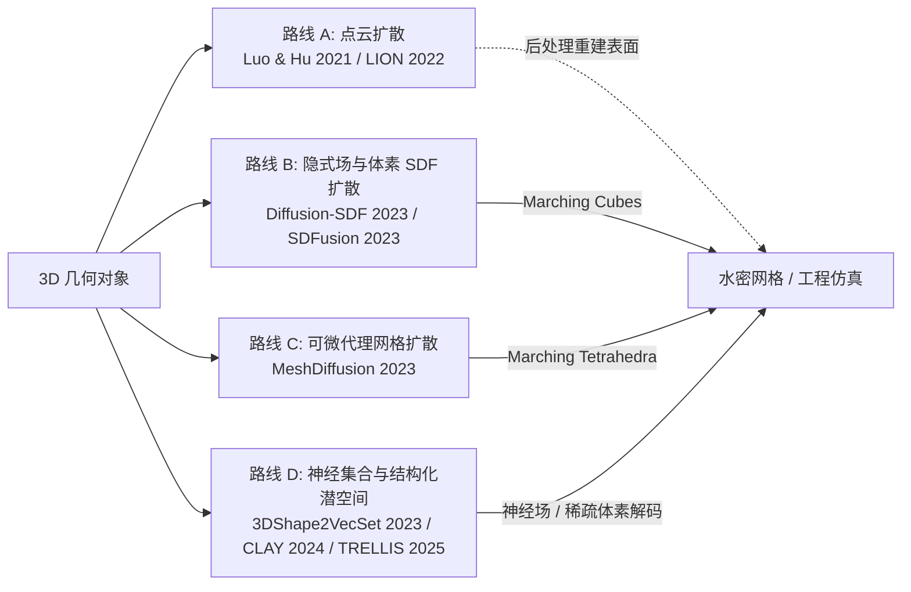

# 3D物体扩散生成方法与几何表示综述

> [!abstract] 核心问题
> 与二维图像（天然规则像素网格）或二维单一翼型（同拓扑、可按周向排成固定点数的一维有序坐标序列）不同，三维物体缺乏统一且通用的规范网格表达。如何选择既能脱离人工参数化限制、支持任意拓扑变化，又能兼顾显存开销、表面光顺度与物理仿真可用性的几何表达，是三维扩散生成（3D Diffusion Generation）的核心瓶颈。本文梳理通用三维视觉/图形学与航空航天工程气动领域的代表性三维扩散文献，并标注各文献的核验状态。
>
> 返回 [[Literature/文献关系总览|文献关系总览]] · [[Literature/Topics/几何表示与性能条件生成|几何表示与性能条件生成]] · [[Literature/Topics/跨布局飞行器生成与新型网络架构|跨布局飞行器生成与新型网络架构]] · [[Literature/待读论文清单|待读论文清单]]。

## 1. 从 2D 到 3D：为什么几何表达会成为核心矛盾？

在二维翼型逆向设计中，Geng 等（*AIAA Journal*, 2026，DOI: [10.2514/1.J066962](https://doi.org/10.2514/1.J066962)）通过统一对比 PCA（Principal Component Analysis，主成分分析）权重、有序 $x$-$y$ 坐标与二维 SDF（Signed Distance Function，有符号距离函数）表明：只要几何拓扑固定且存在空间连续的显式有序排列，直接对坐标序列做一维卷积扩散即可超越低维参数化，无需依赖人工压缩表达。

然而一旦推广到**三维物体**或**跨布局飞行器**，上述前提不再成立：
1. **无序性与变拓扑**：三维点云缺乏自然的一维遍历顺序，三维网格（Mesh）的顶点数与面片连接拓扑随构型变化（例如常规布局有尾翼、飞翼无尾翼、鸭式布局前翼前置），无法直接塞入固定维度卷积网络。
2. **维度灾难与细节损失**：将三维 SDF 直接离散为三维体素网格，参数量与显存按分辨率立方级 $\mathcal{O}(N^3)$ 增长；分辨率偏低则会磨平前缘、翼梢小翼和尖锐折边等关键几何细节。
3. **图形渲染 vs. 物理仿真的鸿沟**：通用视觉模型追求视觉合理与多样，而航空气动设计额外要求表面水密（watertight）、曲率连续（$C^1/G^1$ 甚至更高光顺度）且可稳定划分体网格进行求解。

## 2. 通用 3D 物体扩散生成的四条主线

### 路线 A：直接 3D 点云扩散（Point Cloud Diffusion）

直接把三维物体表示为 $N$ 个空间坐标点的集合 $\{(x_i, y_i, z_i)\}_{i=1}^N$，绕开拓扑连接约束，是最早实现跨类别三维扩散的路线。

| 论文 | 作者 / 会议 / 年份 | 核心机制 | 优势与局限 | 原文链接 |
| --- | --- | --- | --- | --- |
| *Diffusion Probabilistic Models for 3D Point Cloud Generation* | Shitong Luo, Wei Hu / CVPR 2021 | 将 DDPM（Denoising Diffusion Probabilistic Model，去噪扩散概率模型）直接应用于无序三维点云，并用形状潜变量调节点云分布 | 实现简单、支持多类别（含 ShapeNet Airplane）；缺少面片拓扑，需泊松重建等后处理才能用于工程仿真 | [arXiv:2103.01458](https://arxiv.org/abs/2103.01458) |
| *LION: Latent Point Diffusion Models for 3D Shape Generation* | Xiaohui Zeng 等 / NeurIPS 2022 | 在分层 VAE（Variational Autoencoder，变分自编码器）的全局形状潜变量与局部点云潜变量两个层级上运行扩散 | 保留局部几何细节并提升生成平滑度；仍依赖点云到网格的重建流程（如 Shape As Points） | [arXiv:2210.06978](https://arxiv.org/abs/2210.06978) |

### 路线 B：3D 有符号距离场 / 隐式场扩散（SDF & Latent SDF Diffusion）

用连续隐式场 $f(x,y,z)$ 描述空间任意点到物体表面的最近距离（内部为负、外部为正、表面为 0），天生不预设组件数量和拓扑连接，是跨拓扑三维建模的经典手段。

| 论文 | 作者 / 会议 / 年份 | 核心机制 | 优势与局限 | 原文链接 |
| --- | --- | --- | --- | --- |
| *Diffusion-SDF: Conditional Generative Modeling of Signed Distance Functions* | Gene Chou, Yuval Bahat, Felix Heide / ICCV 2023 | 针对连续三维 SDF 进行条件扩散建模（Geng 等 2026 引用为三维扩展代表） | 表达连续、天然支持拓扑变化并可通过 Marching Cubes（移动立方体算法）提取水密表面；高分辨率直接采样成本高 | [DOI:10.1109/ICCV51070.2023.00215](https://doi.org/10.1109/ICCV51070.2023.00215) |
| *Diffusion-SDF: Text-to-Shape via Voxelized Diffusion* | Muheng Li 等 / CVPR 2023 | 采用两阶段体素化 SDF 扩散架构（基础低分辨率生成 + 局部块超分辨率细化） | 缓解单一高分辨率体素扩散的显存压力；分阶段级联引入额外推理耗时 | [arXiv:2212.03293](https://arxiv.org/abs/2212.03293) |
| *SDFusion: Multimodal 3D Shape Completion, Reconstruction, and Generation* | Yen-Chi Cheng 等 / CVPR 2023 | 先用 3D VQ-VAE（Vector Quantized Variational Autoencoder，矢量量化变分自编码器）将三维 SDF 压缩至低维体素潜空间，再运行 3D U-Net 扩散 | 显著降低直接 3D SDF 扩散的 $\mathcal{O}(N^3)$ 计算代价，易于融合文本、图像、局部几何等多模态条件 | [arXiv:2212.04493](https://arxiv.org/abs/2212.04493) |

### 路线 C：可微代理网格扩散（Proxy Mesh Diffusion）

传统三角网格具有不规则图结构和可变顶点数量，无法直接套用规则张量加噪去噪。代表工作通过“固定四面体背景网格 + 可变形表面提取”绕开这一难题。

| 论文 | 作者 / 会议 / 年份 | 核心机制 | 优势与局限 | 原文链接 |
| --- | --- | --- | --- | --- |
| *MeshDiffusion: Score-based Generative 3D Mesh Modeling* | Zhen Liu 等 / ICLR 2023 (Spotlight) | 基于 DMTet（Deformable Marching Tetrahedra，可变形移动四面体网格），在固定规则四面体网格上存储 SDF 值与顶点偏移，对其运行 3D U-Net 扩散，再经可微等值面提取得到三角网格（Geng 等 2026 引用文献） | 直接输出高质量水密三角网格并保留锐利边缘细节；受限于背景四面体网格的空间分辨率与显存开销 | [arXiv:2303.08133](https://arxiv.org/abs/2303.08133) |

### 路线 D：神经向量集合与结构化 3D 潜空间（2023–2025 大规模生成前沿）

为彻底摆脱规则 3D 卷积网格的分辨率限制并实现跨任意拓扑的大规模资产生成，近年主流转向 **Transformer / DiT（Diffusion Transformer，扩散变换器）+ 非网格潜空间** 架构。

| 论文 | 作者 / 会议 / 年份 | 核心机制 | 优势与局限 | 原文链接 |
| --- | --- | --- | --- | --- |
| *3DShape2VecSet: A 3D Shape Representation for Neural Fields and Generative Diffusion Models* | Biao Zhang, Jiapeng Tang, Matthias Nießner, Peter Wonka / SIGGRAPH (ACM TOG) 2023 | 将任意拓扑三维形状编码为一组无序潜向量集合（VecSet），再通过交叉注意力解码为连续神经占据/SDF 场 | 摆脱规则体素网格束缚，对跨类别任意拓扑适应极强；神经场在极端薄壁（如机翼后缘）处的解析精度需额外保障 | [arXiv:2301.11445](https://arxiv.org/abs/2301.11445) |
| *CLAY: A Controllable Large-scale Generative Model for Creating High-quality 3D Assets* | Longwen Zhang 等 / SIGGRAPH 2024 (Honorable Mention) | 基于多分辨率神经场 VAE 与 DiT 架构的大规模三维扩散模型，支持多模态与几何控制 | 跨类别泛化能力极强、生成质量达到工业资产级；训练依赖大规模算力与清洗后三维资产库 | [arXiv:2406.13897](https://arxiv.org/abs/2406.13897) |
| *TRELLIS: Structured 3D Latents for Scalable and Versatile 3D Generation* | Jianfeng Xiang 等 / CVPR 2025 (Spotlight) | 提出结构化三维潜空间 SLAT（Structured Latents），将稀疏激活表面体素与局部高维特征结合，配合流匹配 Transformer 统一解码为 Mesh、3DGS（3D Gaussian Splatting，三维高斯溅射）与神经辐射场 | 兼顾稀疏空间结构与表面几何细节，支持多种下游三维格式输出；面向视觉资产训练，未内嵌气动/物理约束 | [arXiv:2412.01506](https://arxiv.org/abs/2412.01506) |

与自回归结构生成路线相比，可对照库内已有笔记 [[Literature/generative/PolyGen An Autoregressive Generative Model of 3D Meshes|PolyGen]]（自回归顶点/面序列）与 [[Literature/generative/ShapeAssembly Learning to Generate Programs for 3D Shape Structure Synthesis|ShapeAssembly]]（层级装配程序）。

---

## 3. 航空航天与工程气动领域的 3D 扩散探索

工程气动外形生成面临比通用图形学更严苛的**表面光顺度与物理保真度**约束，目前可划分为两类路线：

### 3.1 参数化 / 模板潜空间 + 条件扩散（当前工程主流）
这类方法仍保留一定参数化或固定表面模板，优先保证生成的三维外形直接可测算：
* **三维飞翼多点逆向设计**：J. H. Li 等（*Physics of Fluids*, 2025，DOI: [10.1063/5.0271723](https://doi.org/10.1063/5.0271723)），*Multi-point aerodynamic inverse design of flying wing using the conditional diffusion model*。在参数化潜空间上构建条件扩散模型，处理飞翼三维构型的多工况气动逆设计。
* **三维压气机叶片逆向设计**：Y. Wu 等（*Physics of Fluids*, 2025，DOI: [10.1063/5.0266874](https://doi.org/10.1063/5.0266874)），*An inverse aerodynamic design framework for compressor blades based on generative model*。面向三维叶栅通道的生成式气动设计。
* **深度潜空间气动探索**：[[Literature/Aerodynamic Shape Design Space Exploration with Deep Latent Diffusion Model|DiffGeo]]（AIAA Journal, 2026，DOI: `10.2514/1.J066320`）。在固定模板网格上利用自动解码器学习几何潜空间，再结合能量梯度引导的潜扩散探索 2D 翼型与 3D 气动外形。
* **固定拓扑 BWB（Blended Wing Body，翼身融合体）条件扩散**：[[Literature/generative_design/aircraft/BlendedNet++ A Dataset and Benchmark for Field-Resolved Aerodynamics and Inverse Design of Blended Wing Body Aircraft|BlendedNet++]]（9 维 BWB 参数条件扩散 + 神经算子代理梯度精修 + CFD 复核）。

### 3.2 面向跨构型 / 无固定模板的 3D 飞行器扩散
这类工作尝试突破单一构型模板限制，直接生成三维点云、网格或混合离散-连续拓扑：
* **三维飞行器跨外形点云-网格扩散**：Youtao Xue 等（《航空学报》/ *Acta Aeronautica et Astronautica Sinica*, 2025，DOI: [10.7527/S1000-6893.2025.31511](https://doi.org/10.7527/S1000-6893.2025.31511)），*Generalization of three-dimensional flight vehicle shape representation using generative models*。面向包含翼身融合体（BWB）等在内的复杂三维飞行器构型，将多视图/截面特征映射到**三维点云条件扩散模型**，并通过可微泊松表面重建输出可直接进行 CFD 验证的水密表面网格。
* **离散拓扑 + 变长连续参数混合扩散**：[[Literature/generative_design/aircraft/Do Diffusion Models Dream of Electric Planes Discrete and Continuous Simulation-Based Inference for Aircraft Design|MixeDiT–MaskeDiT]]（ICML 2026）。不依赖三维体素或无序点云，而是将离散构型拓扑 $\tau$ 与变长连续部件参数 $\theta_\tau$ 分层解耦，直接跨越 144 种飞行器构型。
* **神经隐式几何压缩参照**：[[Literature/Scalable Parameterization of Aerodynamic Shapes Using Deep-Learning-Based Geometric Compression|3D AeroINR]]（AIAA Journal, 2026，DOI: `10.2514/1.J066018`）展示了用连续神经隐式表示压缩任意三维气动外形的路径，可与条件扩散结合作为解码后端。

---

## 4. 对“跨布局飞行器生成”研究的方法论启示

综合 Geng 等（2026）与上述 3D 扩散文献，可得到三个核心判断（作为项目研究假设，非已证实统一定理）：

1. **不能盲目丢弃结构，也不能被固定模板锁死**：2D 翼型之所以能抛弃 PCA/CST 参数化，是因为有序坐标点列已经提供了低成本的拓扑对齐先验。到了 3D 跨布局飞行器，不同布局的部件数量和连接关系完全不同，**直接硬做高分辨率 3D 规则体素 SDF（如简单扩展 Geng 的 2D SDF）会面临参数量爆炸与前/后缘失真问题**。
2. **两条可行的 3D 跨布局去参数化/弱参数化路径**：
   * **几何场压缩路线**：借鉴 **SDFusion / 3DShape2VecSet / TRELLIS**，先通过自动编码器或稀疏特征体素把任意拓扑三维外形编码进紧凑潜空间再做扩散，重点需要攻克**机翼薄翼尖/尖锐尾缘的几何保真度**与**水密 CAD/CFD 网格导出**。
   * **结构化组件混合路线**：借鉴 **MixeDiT–MaskeDiT / ShapeAssembly / GLUE**，保留部件级语义与物理参数（而非整机死模板），通过“离散组件拓扑图 + 变长部件连续几何”实现可解释、直接可装配且便于接入多学科分析的跨布局生成。
3. **条件控制与多目标机制可直接复用**：Geng 等（2026）提出的 **EDM 连续噪声预调节** 与 **“主气动目标条件采样设计池 + 任意次要目标后筛选”** 范式，无需将所有约束硬编码进条件端即可实现灵活多目标设计，适合迁移至 3D 飞行器多学科筛选流程。

---

## 5. 证据与核验状态说明

> [!warning] 证据边界
> - **全文精读核验**：Geng 等（2026，工作区本地 PDF 已逐页核对）；库内既有精读笔记 [[Literature/Aerodynamic Shape Design Space Exploration with Deep Latent Diffusion Model|DiffGeo]]、[[Literature/generative_design/aircraft/BlendedNet++ A Dataset and Benchmark for Field-Resolved Aerodynamics and Inverse Design of Blended Wing Body Aircraft|BlendedNet++]]、[[Literature/generative_design/aircraft/Do Diffusion Models Dream of Electric Planes Discrete and Continuous Simulation-Based Inference for Aircraft Design|MixeDiT–MaskeDiT]]。
> - **文献检索与元数据核验（待单篇深读）**：Luo & Hu (2021)、LION (2022)、Diffusion-SDF (ICCV 2023 & CVPR 2023)、SDFusion (2023)、MeshDiffusion (2023)、3DShape2VecSet (2023)、CLAY (2024)、TRELLIS (2025)、Li 等 (2025)、Wu 等 (2025)、Xue 等 (2025)。本综述仅归纳其已核实的几何表示机制、作者年份与公开链接，未推演未核对原文的超参数或定量对比数据。
