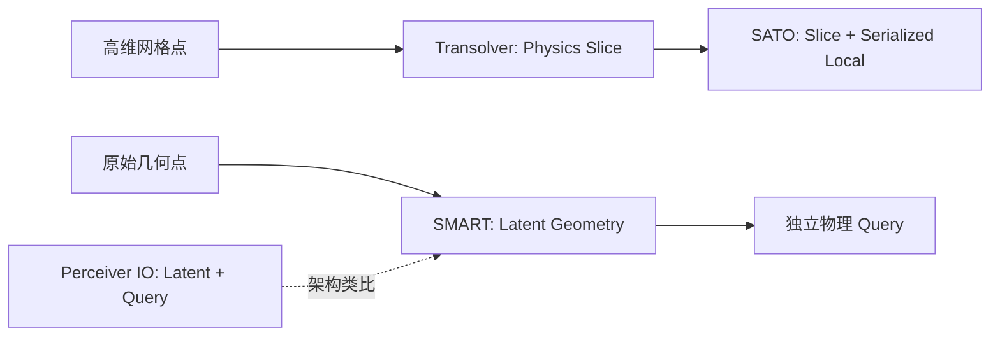

# Transformer 与物理场算子

> [!abstract] 核心问题
> 物理场具有高分辨率、不规则几何、长程耦合和工况依赖。下列论文分别回答：“**什么是 token、谁和谁做 attention、在哪里做多尺度、如何注入边界/工况、如何查询输出**？”同属 Transformer，不等于可直接互换的网络。

返回 [[Literature/文献关系总览|文献关系总览]]；工程使用情境见 [[Literature/Topics/机翼生成器研究对照与证据边界|机翼生成器研究对照]]。

## 机制谱系（先看不同的计算单元）

| 论文 | 注意力/数据单元 | 解决的瓶颈 | 必须注意的边界 |
| --- | --- | --- | --- |
| [[Literature/transformer/Star-Transformer|Star-Transformer]] | 邻接环 + 全局 relay | 稀疏化、局部与全局通信分工 | 文本任务验证，不是 PDE 算子 |
| [[Literature/transformer/Perceiver IO|Perceiver IO]] | 固定 latent + 输出 query | 高维输入、结构化任意输出 | 不自带物理守恒和几何归纳偏置 |
| [[Literature/transformer/Transolver|Transolver]] | 学习到的 physics slice | 不规则大量网格点的全局关系 | 必须从参数化几何构造合理的空间输入特征 |
| [[Literature/transformer/Spatially-aware transformer operator for real-time aerodynamic evaluations of arbitrary three-dimensional vehicles|SATO]] | physics slice + serialized patch | 恢复局部边界/细节 | 序列化和局部邻域会影响分辨率行为 |
| [[Literature/transformer/SMART - Scalable Mesh-free Aerodynamic Simulations from Raw Geometries using a Transformer-based Surrogate Model|SMART]] | 原始几何 latent + 独立空间 query | 免仿真网格输入、可分块查询 | 查询独立是特定架构性质，不能推广到所有解码器 |
| [[Literature/transformer/Uformer - A General U-Shaped Transformer for Image Restoration|Uformer]] | 多尺度局部窗口 | U-shaped 主干与局部先验 | 图像恢复背景，不直接证明非结构网格精度 |
| [[Literature/transformer/Towards a Foundation-Model Paradigm for Aerodynamic Prediction in Three-dimensional Design|AeroTransformer]] | 结构化机翼 patch | 全局/局部场预测与迁移学习 | 统一网格假设重要；与不规则点云方案条件不同 |
| [[Literature/transformer/Unisolver|Unisolver]] | domain-wise + point-wise PDE 条件 | 边界、方程、物理参数的深层条件注入 | 论文关注多 PDE 家族，不是整机气动基础模型的直接证明 |

## 两条重点关系：哪些是真的承接？

**方法承接：** [[Literature/transformer/Transolver|Transolver]] → [[Literature/transformer/Spatially-aware transformer operator for real-time aerodynamic evaluations of arbitrary three-dimensional vehicles|SATO]]。SATO 保留 Physics-Attention 的全局物理切片聚合，再借助空间序列化 patch attention 加强小尺度/局部特征。不是把 Transolver 的物理切片换成局部窗口。

**类比而非可验证继承：** [[Literature/transformer/Perceiver IO|Perceiver IO]] ↔ [[Literature/transformer/SMART - Scalable Mesh-free Aerodynamic Simulations from Raw Geometries using a Transformer-based Surrogate Model|SMART]]。前者将输入交叉注意力到 latent，输出 query 再从 latent 读取；后者对原始几何采样构建 latent geometry，再让每个物理查询读取它并逐层更新。它们的共享抽象是“低维瓶颈 + 查询输出”，而非同一实现。

## 条件与多尺度是正交维度

- **条件调制**：[[Literature/transformer/Scalable Diffusion Models with Transformers|DiT]] 说明 in-context token、cross-attention 与 Adaptive Layer Normalization（adaLN，自适应层归一化）及其零初始化门控的不同；[[Literature/transformer/Unisolver|Unisolver]] 进一步按 PDE 域级与位置级组件组织工况。**这些是条件注入策略，不自动决定几何 token 的含义。**
- **多尺度**：[[Literature/transformer/Uformer - A General U-Shaped Transformer for Image Restoration|Uformer]] 的 U 形编码—瓶颈—解码 + 局部窗口，为结构化高分辨率物理场提供启发；[[Literature/transformer/Towards a Foundation-Model Paradigm for Aerodynamic Prediction in Three-dimensional Design|AeroTransformer]] 使用建立在 PDE-Transformer 上的层级主干（PDE-Transformer 原文尚未在仓库形成独立笔记）。
- **序列先验**：[[Literature/transformer/How Far Should Tokenization Go - Predictive Effectiveness and Relational Losslessness|How Far Should Tokenization Go?]] 讨论哪些结构应在 token 接口固化、哪些依赖上下文的关系应留给模型。[[Literature/transformer/Lost in the Middle at Birth - An Exact Theory of Transformer Position Bias|Lost in the Middle at Birth]] 为因果注意力中的位置路由偏置提供理论；两者可帮助诊断变长几何 token 的表示与位置风险，**并非直接气动模型实验结果**。

## “低维 CST 参数 → 高维物理预测”的接口

一种可检验的项目假设是：

1. 生成器输出截面参数与全局尺度、翼展布局；
2. **确定性、可微的几何采样**在规定表面坐标/网格点上重建三维坐标、法向、局部弦长和对应工况特征；
3. 用 [[Literature/transformer/Transolver|Transolver]] 或 [[Literature/transformer/Spatially-aware transformer operator for real-time aerodynamic evaluations of arbitrary three-dimensional vehicles|SATO]] 处理离散物理点，并回归压力/面元升阻力矩；
4. 使用物理积分获得全局量，必要时设计辅助全局损失；
5. 将误差对采样坐标和生成参数反传。

这不是“几何参数维数扩展后信息变多”：**高分辨率物理点增加的是局部计算、几何归纳偏置和输出查询位置，而不是原始几何自由度**。对输入变化、采样密度、点数、OOD（分布外）与积分量的准确性必须独立评估。

## 阅读顺序

[[Literature/transformer/Perceiver IO|Perceiver IO]] → [[Literature/transformer/Transolver|Transolver]] → [[Literature/transformer/Spatially-aware transformer operator for real-time aerodynamic evaluations of arbitrary three-dimensional vehicles|SATO]] / [[Literature/transformer/SMART - Scalable Mesh-free Aerodynamic Simulations from Raw Geometries using a Transformer-based Surrogate Model|SMART]] → [[Literature/transformer/Unisolver|Unisolver]] / [[Literature/transformer/Towards a Foundation-Model Paradigm for Aerodynamic Prediction in Three-dimensional Design|AeroTransformer]]，随后补 [[Literature/transformer/Scalable Diffusion Models with Transformers|DiT]]、[[Literature/transformer/Uformer - A General U-Shaped Transformer for Image Restoration|Uformer]]。已有长篇综合分析见 [[Literature/transformer/Transformer架构创新论文关联与项目设计参考|Transformer 架构创新综述]]。
