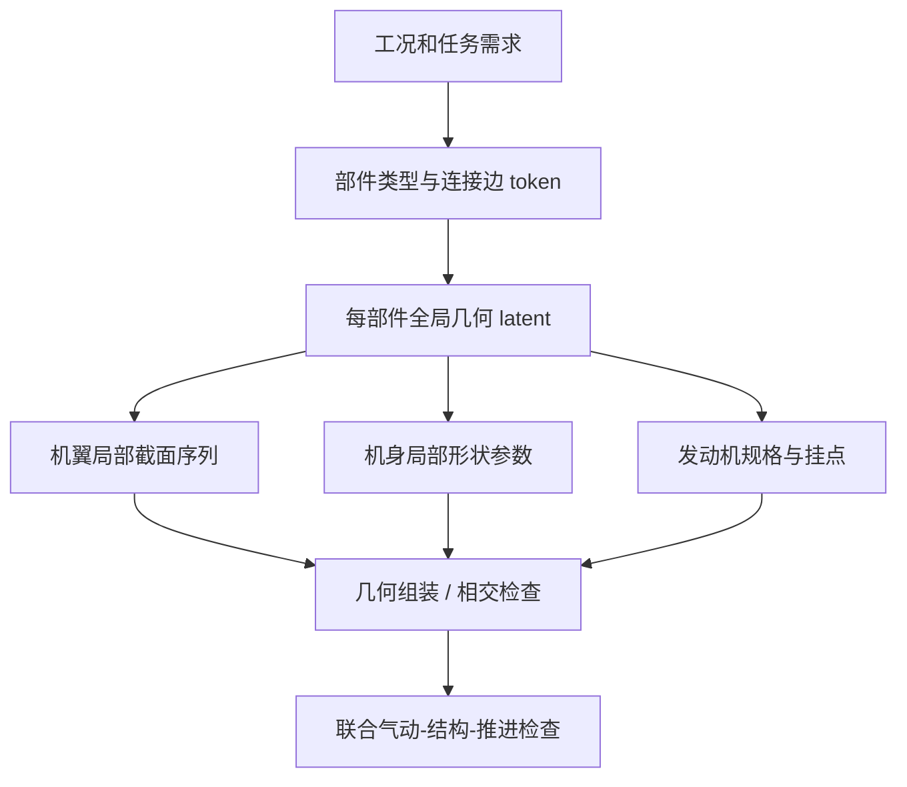

# 整机设计与工程智能体

> [!abstract] 核心问题
> 整机生成比单翼型/机翼复杂：系统具有多类部件、安装位置、连接拓扑和多学科约束，还要将知识检索、代码执行与物理验证分开。现有论文提供**分散的模块性证据**，尚不能直接拼出一个已验证的“任意构型整机生成基础模型”。

返回 [[Literature/文献关系总览|文献关系总览]]。跨布局与新型生成网络专题见 [[Literature/Topics/跨布局飞行器生成与新型网络架构|跨布局飞行器生成与新型网络架构]]。

## 三种不同层级的研究

| 层级 | 代表笔记 | 已经解决的问题与重要限制 |
| --- | --- | --- |
| 生成概念参数分布 | [[Literature/A comparison of methodologies for generating design-requirement-driven conceptual aircraft designs|A comparison of methodologies for generating design-requirement-driven conceptual aircraft designs]] | 对比 VAE、normalizing flow 和 diffusion 的构型样本分布；笔记明确指出主体实验**不是按需求硬条件生成** |
| 用代理进行多学科优化 | [[Literature/Advanced UAV Design Optimization Through Deep Learning-Based Surrogate Models|Advanced UAV Design Optimization]] | 用多学科性能代理与多目标优化探索无人机设计需求，仍依赖预设参数化和流程 |
| 从自然语言执行工程工作流 | [[Literature/Aerodynamic Design and Optimization via a Specialized Agentic Generative AI Framework|Agentic Generative AI Framework]] | 自动生成、运行、分析 OpenAeroStruct 优化脚本；是工作流编排，不是可变拓扑几何生成网络 |
| 检索航空知识并增强推理 | [[Literature/DR-RAG Domain-Rule-based Retrieval-Augmented Generation for aviation digital model design|DR-RAG]] | 知识图谱 + 规则约束 + 检索增强生成；不等于数值仿真或可微优化 |

两条可互补的线：[[Literature/Aerodynamic Design and Optimization via a Specialized Agentic Generative AI Framework|Agentic Workflow]] 负责工具调用/数值脚本执行；[[Literature/DR-RAG Domain-Rule-based Retrieval-Augmented Generation for aviation digital model design|DR-RAG]] 负责知识来源和规则约束。它们可以出现在同一个设计助手系统内，但仓库中的两篇文献**没有共同验证这一组合**。

## 整机构型表示：连续与离散变量应分层处理

- **部件语义**：机翼、机身、发动机、尾翼，以及每类部件的局部几何参数。
- **拓扑连接**：发动机翼挂/机身安装，机翼相对机身位置、尾翼类型等，以明确的 connection/edge 表达，而非假设所有自由度都能写进一个 wing-section token。
- **全局约束**：质量、重心、发动机推力、升力包线、载荷、尺寸限制等。
- **物理条件输出**：[[Literature/transformer/Transolver|Transolver]] / [[Literature/transformer/SMART - Scalable Mesh-free Aerodynamic Simulations from Raw Geometries using a Transformer-based Surrogate Model|SMART]] / [[Literature/transformer/Towards a Foundation-Model Paradigm for Aerodynamic Prediction in Three-dimensional Design|AeroTransformer]]代表不同类别的流场预测代理；其现有笔记**并未证明任意连通构型可直接 zero-shot 预测**。
- **可控生成形式**：[[Literature/transformer/SkexGen - Autoregressive Generation of CAD Construction Sequences with Disentangled Codebooks|SkexGen]] 的拓扑/几何解耦是有价值的**表示类比**，但 CAD 命令语义与飞机构型图需要进一步定义。

## 可能的模型组织（仅项目研究建议）

- 类别/连接由离散模块预测，连续尺寸/形状由条件分布输出；可以共享主干再用类型化解码头，**不必默认每个组件和 CST 截面采用同一 token 结构**。
- 通过组件级 cross-attention 或图消息传递将相对安装关系传播给局部截面 token；不要让模型从几何位置数值中隐式猜所有连接。
- 先验证固定拓扑/固定组件族的组合泛化，再扩大到变长组件与新连接方式；物理代理的训练域必须覆盖这些组合。

关于生成分布与约束、多保真物理反馈分别见 [[Literature/Topics/几何表示与性能条件生成|几何生成]]、[[Literature/Topics/气动代理与多保真学习|代理学习]]、[[Literature/Topics/机翼生成器研究对照与证据边界|当前研究路线对照]]。

## 近期跨布局生成的三条实证路线（2026-10-25）

- **结构化拓扑后验：** [[Literature/transformer/Do Diffusion Models Dream of Electric Planes Discrete and Continuous Simulation-Based Inference for Aircraft Design|MixeDiT–MaskeDiT]] 在 144 种 eVTOL 拓扑的预定义构型空间里将离散拓扑与连续参数分层生成，已经验证多种性能条件会影响拓扑概率。其真实标签来自 SUAVE 概念分析，尚不能作为高保真 CFD 证据。
- **共享点云外形：** [[Literature/基于生成式模型的三维气动外形设计框架|三维气动外形基础模型]] 通过共享点云编码/解码器与潜扩散生成多类外形。公开摘要能支持多外形族表示，但不能证明任意 CAD 拓扑连接与结构可行性。
- **冻结组件协同：** [[Literature/GLUE Coordinating Pre-Trained Generative Models for System-Level Design|GLUE]] 在不重新训练 wing/fuselage/internals 子模型的情况下学习系统级 latent 和接口约束，但固定组件架构，缺少变长拓扑和高保真动力学验证。

**区别**：前者改变“有什么部件”，第二种改变“外形点云长什么样”，第三种解决“已有子模型能否协调工作”。把三者组合是待检验系统架构，而非现有文献已实现的一体化基础模型。
