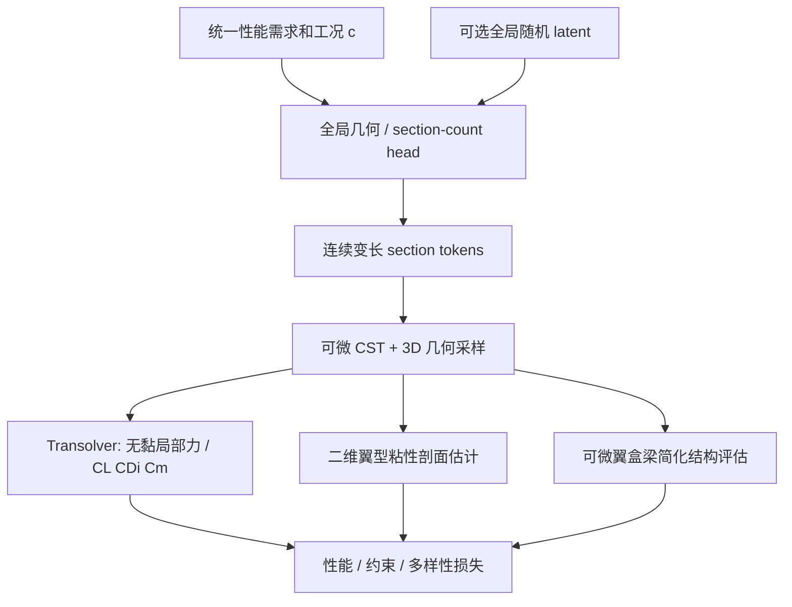

# 机翼生成器研究对照与证据边界

> [!abstract] 使用说明
> **本页是将既有文献联系到当前 GRASS-plane/机翼生成器讨论的研究假设，不是某篇论文的结论或已完成实验记录。** 目标包括连续变长截面输出、给定升力/尺寸/速度/过载/翼重要求，使用可微气动/结构代理构造可验证的设计闭环，并逐步扩展到机身/发动机/拓扑连接。

返回 [[Literature/文献关系总览|文献关系总览]]。

## 0. 先把三个不同分布分清

1. **几何数据分布** $p(x)$：哪些机翼形状在样本库中出现过；[[Literature/transformer/SkexGen - Autoregressive Generation of CAD Construction Sequences with Disentangled Codebooks|SkexGen]]、[[Literature/DiffAirfoil An Efficient Novel Airfoil Sampler Based on Latent Space Diffusion Model for Aerodynamic Shape Optimization|DiffAirfoil]]等关心表示与生成。
2. **条件逆设计分布** $p(x\mid c)$：给定性能/工况 $c$ 可有哪些机翼；[[Literature/PcDGAN - A Continuous Conditional Diverse Generative Adversarial Network For Inverse Design|PcDGAN]]强调同条件下准确且多样。
3. **工程可行设计集合** $\{x:g_j(x,c)\leq 0\}$：来自流动、结构、制造、重量、构型连接等物理约束；任何概率头本身都不保证属于该集合。

## 1. 建议采用分层 token 与可微物理采样

**为什么不是“直接让 Transolver 吃 5×20 维 CST”**：[[Literature/transformer/Transolver|Transolver]]原本在网格/空间点上做物理关系建模，生成器则在低维参数上表达几何。设计一个 deterministic geometry decoder 将 CST/位置还原为可微面元坐标，保留空间结构与法向/面积，让高分辨率 physics token 负责物理计算和 query，符合 [[Literature/transformer/Perceiver IO|Perceiver IO]] 和 [[Literature/transformer/SMART - Scalable Mesh-free Aerodynamic Simulations from Raw Geometries using a Transformer-based Surrogate Model|SMART]]关于 latent/query 的架构启发。

**高维采样不是额外几何信息**。它引入的是物理评估所需的局部位置和积分结构，这一点必须靠采样密度与网格外推消融验证。

## 2. 生成器与训练损失：哪些文献能支持哪些环节

| 项目环节 | 可借鉴的论文证据 | 仍需独立验证 |
| --- | --- | --- |
| 连续性能条件 + 多方案输出 | [[Literature/PcDGAN - A Continuous Conditional Diverse Generative Adversarial Network For Inverse Design|PcDGAN]] / [[Literature/PaDGAN 与 PcDGAN：关系、差异与选择|与 PaDGAN 的对照]] | GMM-NLL 对连续多维截面序列是否稳定；同条件多解是否真实 |
| 全局参数与局部截面解耦 | [[Literature/transformer/SkexGen - Autoregressive Generation of CAD Construction Sequences with Disentangled Codebooks|SkexGen]]、[[Literature/transformer/How Far Should Tokenization Go - Predictive Effectiveness and Relational Losslessness|tokenization 边界]] | 全局 head 与截面 head 的条件一致性；不能照搬离散 CAD 码本 |
| 每层条件注入 | [[Literature/transformer/Scalable Diffusion Models with Transformers|DiT]]、[[Literature/transformer/Unisolver|Unisolver]] | adaLN / cross-attention / prefix 的对照消融，不应预设赢家 |
| 物理代理 backbone | [[Literature/transformer/Transolver|Transolver]]、[[Literature/transformer/Spatially-aware transformer operator for real-time aerodynamic evaluations of arbitrary three-dimensional vehicles|SATO]]、[[Literature/transformer/SMART - Scalable Mesh-free Aerodynamic Simulations from Raw Geometries using a Transformer-based Surrogate Model|SMART]] | 几何采样误差、局部负载、未见构型泛化与积分误差 |
| 气动力积分与辅助损失 | [[Literature/transformer/Towards a Foundation-Model Paradigm for Aerodynamic Prediction in Three-dimensional Design|AeroTransformer]] | 当前 Transolver 局部输出、面元面积法向与总系数之间的一致性 |
| 多保真校正与主动加点 | [[Literature/Multi-fidelity convolutional neural network surrogate model for aerodynamic optimization based on transfer learning|MFCNN-TL]]、[[Literature/Generation of surrogate-based aerodynamic model of an UCAV configuration using an adaptive co-Kriging method|Co-Kriging]]、[[Literature/Toward Accelerating Discovery via Physics-Driven and Interactive Multifidelity Bayesian Optimization|MFBO]] | 高保真数据覆盖、误差不确定性、预算配置 |
| 约束可行与风险 | [[Literature/An ensemble weighted average conservative multi-fidelity surrogate modeling method for engineering optimization|保守代理]]、[[Literature/SURROOPT A GENERIC SURROGATE-BASED OPTIMIZATION CODE FOR AERODYNAMIC AND MULTIDISCIPLINARY DESIGN|SURROOPT]] | 代理高估性能的概率、局部极值、边界可行性 |
| 优化搜索中的多样性 | [[Literature/PaDGAN - A Generative Adversarial Network for Performance Augmented Diverse Designs|PaDGAN]]、[[Literature/PcDGAN - A Continuous Conditional Diverse Generative Adversarial Network For Inverse Design|PcDGAN]] | 选择的几何相似核与“工程方案差异”的一致性 |

## 3. 近期确认的物理接口和边界

- **无黏代理**：现有 Transolver 用于预测面元无量纲升力、阻力、俯仰力矩；要区分无黏诱导阻力与实际型阻，不能用无黏 $C_D$ 直接当完整阻力。
- **粘性估计**：先考虑以 NeuralFoil 估计二维截面粘性剖面特性，再沿展向积分。**三维失速、雷诺数变化、局部干扰和机翼/机身交互不由此自动解决。**
- **结构模块**：可参考 OpenAeroStruct（OAS）的翼盒截面—梁理论、剪力/弯矩/扭矩与重量计算思想，移植可微 PyTorch 形式，但 OAS 不是一个“只吃两个厚度就可验证任意机翼强度”的万能黑盒。结构强度还依赖材料、几何、加载、边界条件及极限准则。
- **极限载荷简化**：取 NeuralFoil 二维最大升力系数附近的工况作为**候选筛选案例**可能有用，但不等于真实飞机设计中的最终极限载荷；需独立检查动压、载荷因子、机动/阵风包线、展向载荷和失速三维影响。
- **训练策略**：先用现有模板几何 + 已有气动与结构可微计算进行预训练；随后在交替训练中逐步提高条件难度、加入外部高保真求解和真实可行性反馈。[[Literature/SURROOPT A GENERIC SURROGATE-BASED OPTIMIZATION CODE FOR AERODYNAMIC AND MULTIDISCIPLINARY DESIGN|SURROOPT]]与[[Literature/Toward Accelerating Discovery via Physics-Driven and Interactive Multifidelity Bayesian Optimization|MFBO]]为外环提供方法参照，**没有直接验证这里的生成器**。

## 4. 关键消融与验收标准（项目建议）

1. **几何保真**：固定 CST 时改变采样点密度/布局，检验局部载荷与积分量的收敛，并用有限差分校验采样 Jacobian。
2. **气动精度**：同一未见模板/截面数/翼展配置上分别报告 $C_L, C_{D,i}, C_m$ 及局部面元误差；对外环使用的误差尤其严格。
3. **条件达成率**：独立报告升力、尺寸、最低速度与翼重约束通过率；不要只看生成 loss。
4. **同条件多样性**：在固定条件下检验经过物理复算仍可行的不同方案比例；避免不可行样本贡献 DPP 多样性。
5. **结构验证**：翼盒梁近似与经验证的结构分析或高保真模型对照，特别是根部载荷和最大应力/挠度。
6. **优化有效性**：随机起点/模板优化基线、只用代理内环、带外部补点的交替训练三组对照；报告真实求解器评估成本。

## 5. 扩展到整机时的架构原则

将截面序列扩展为 **部件级 typed tokens（类型化 token） + connection edges（连接边） + 各部件局部连续解码器**。机身/发动机不一定要与翼型截面共享 token 形态；全局/局部条件可通过图消息传递或 cross-attention 交换。这个建议结合 [[Literature/transformer/SkexGen - Autoregressive Generation of CAD Construction Sequences with Disentangled Codebooks|SkexGen]] 的几何/拓扑解耦、[[Literature/transformer/Unisolver|Unisolver]] 的条件分层以及 [[Literature/Topics/整机设计与工程智能体|整机设计专题]]，**不是上述论文直接提供的验证方案**。

## 6. 文献库尚未单独收录的证据

本次仓库中没有单独的 NeuralFoil、OpenAeroStruct、PDE-Transformer、Swin Transformer 笔记；它们在先前讨论或已有 [[Literature/transformer/Transformer架构创新论文关联与项目设计参考|Transformer 综合笔记]]中出现，不能视为本文已再次检验了对应源码/最新实验。
