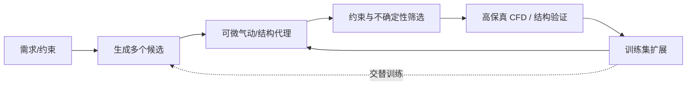

# 气动优化与设计空间探索

> [!abstract] 核心问题
> 复杂飞行器设计的昂贵部分不只是找到较小的损失，还包括**可行域、几何维数、全局多峰、物理仿真预算和代理误差**。这些论文分别处理不同瓶颈。

返回 [[Literature/文献关系总览|文献关系总览]]。

## 以“可否直接获得梯度”分叉

- **有可信的状态方程与形状灵敏度**：[[Literature/Aerodynamic Design via Control Theory|Jameson (1988)]] 把流场写成 PDE 约束优化，利用伴随求导减少梯度成本。该文笔记特别指出其主体是方法推导，**无数值实验**。
- **高代价黑箱 / 不便求梯度**：[[Literature/SURROOPT A GENERIC SURROGATE-BASED OPTIMIZATION CODE FOR AERODYNAMIC AND MULTIDISCIPLINARY DESIGN|SURROOPT]] 采用代理模型 + 优化建议 + 高保真评价 + 再训练的闭环，可处理多目标和多学科。
- **主动决定新样本位置、保真度**：[[Literature/Toward Accelerating Discovery via Physics-Driven and Interactive Multifidelity Bayesian Optimization|交互式多保真 BO]]，其中 Bayesian Optimization（BO，贝叶斯优化）的采样价值不仅是降低局部预测误差，还要控制下一轮评估成本。

它们可以在工程流程不同环节组合，但**不是同一个优化算法从旧到新的单线升级**。

## 三种“降维”并不等价

| 论文 | 压缩的对象/坐标 | 核心思想 | 潜在偏差 |
| --- | --- | --- | --- |
| [[Literature/Global aerodynamic design optimization based on data dimensionality reduction|Qiu et al. POD]] | 翼型/机翼几何设计变量 | Proper Orthogonal Decomposition（本征正交分解），提高全局优化效率 | 样本形成的基底可能限制未见形状 |
| [[Literature/Data-driven surrogate model for aerodynamic design using separable shape tensor method|Separable Shape Tensor]] | 几何形状与仿射变换 | Grassmann manifold（格拉斯曼流形）+ Principal Geodesic Analysis（主测地分析） | 有效性依赖形状流形和变换假设 |
| [[Literature/High-dimensional efficient global optimization using both random and supervised embeddings|EGORSE]] | 高维黑箱优化变量 | 随机与监督嵌入结合，迭代更新低维搜索空间 | 有效低维性和逆映射可行域需验证 |

这三条思路可启发截面 CST 参数、全局机翼尺寸和拓扑变量的分层搜索，但不能把离散连接方式直接当作一个连续线性子空间。

## 不确定性与多目标

- [[Literature/An ensemble weighted average conservative multi-fidelity surrogate modeling method for engineering optimization|EWA Conservative MF]]：通过误差/不确定性构造更保守的约束裕度。**高 $R^2$ 的代理也可能给出假可行解**。
- [[Literature/Advanced UAV Design Optimization Through Deep Learning-Based Surrogate Models|UAV 多目标代理设计]]：关注整机气动、结构、隐身、推进等多学科权衡，而非仅优化一个翼型升阻比。
- [[Literature/Aerodynamic shape optimization of airfoils across rarefied to continuum regimes using deep reinforcement learning|CrossAero]]：以 Knudsen 数的概率密度分布表达多个流域工况的重要度，用深度强化学习学习设计策略；与 [[Literature/Learning efficient navigation in vortical flow fields|涡流导航 RL]] 的动作对象、物理目标完全不同。
- [[Literature/PaDGAN - A Generative Adversarial Network for Performance Augmented Diverse Designs|PaDGAN]] / [[Literature/PcDGAN - A Continuous Conditional Diverse Generative Adversarial Network For Inverse Design|PcDGAN]]：改善候选生成分布和条件多样性；**生成器训练≠高保真评估的最优性证明**。

## 可用于机翼项目的闭环（设计建议）

- **内环**可用代理端到端提供梯度；**外环**用真实求解器验证与补点。
- 初期先实现物理一致的数值可行性，再逐步提高条件严苛程度，不应只按代理输出最大值筛选。
- 对多峰设计问题，通过 DPP 保持同条件候选差异，但还需高保真筛选和约束满足率报告。

延伸：[[Literature/Topics/几何表示与性能条件生成|生成器]]、[[Literature/Topics/气动代理与多保真学习|代理]]、[[Literature/Topics/机翼生成器研究对照与证据边界|项目研究对照]]。
