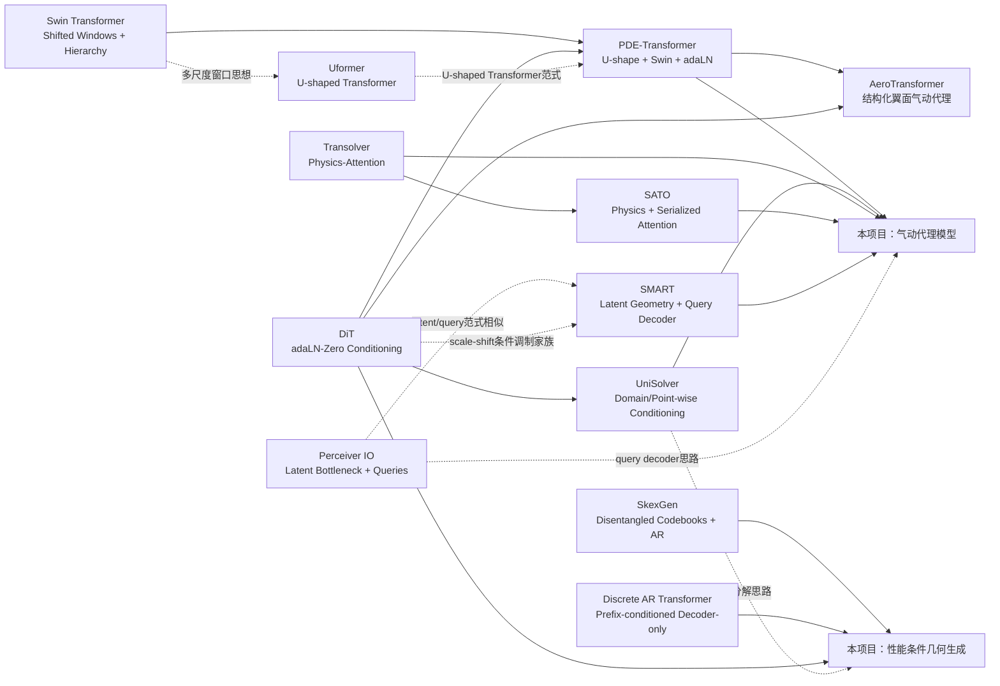
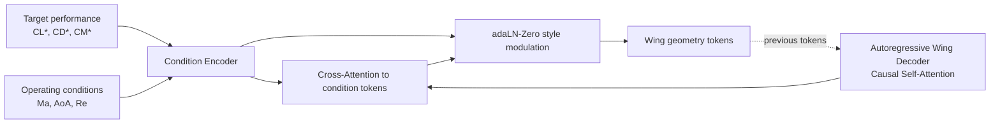
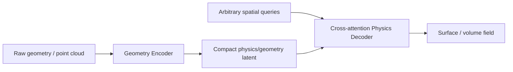

# Transformer 架构创新论文关联与项目设计参考

> [!note] 专题版本边界（2026-10-25）
> 本文是围绕早期 **Transformer 气动代理 + 条件几何生成** 两个应用目标整理的 11 篇相关研究，不是全部高效网络架构的总目录。S4 / Mamba / Mamba-2 / Mamba-3 / RetNet / GLA / Gated DeltaNet / Hyena 和 Fast-Weight Attention 的机制比较已单独整理到 [[Literature/Topics/神经网络架构与高效序列建模|神经网络架构与高效序列建模]]。保留旧正文供历史复查，避免把后来论文反向写成其原始知识范围。


> [!abstract]
> 本笔记围绕两个目标整理 11 篇论文：
> 1. **性能导向的条件 Transformer Decoder**：根据目标性能/工况生成几何序列；
> 2. **Transformer 气动代理模型**：由几何与工况预测表面/体流场以及积分气动力。
>
> 与其逐篇孤立总结，本文按 **“注意力如何扩展到高维物理场 → 如何做多尺度 → 如何注入条件 → 如何处理不规则几何 → 如何做条件几何生成”** 的技术脉络组织，并明确区分**直接继承关系**与**概念上的相似关系**。

---

# 1. 先看全局：这些论文解决的是 Transformer 的不同瓶颈

| 论文                          | 核心问题                          | 核心创新                                                                  | 对本项目的主要价值                          |
| --------------------------- | ----------------------------- | --------------------------------------------------------------------- | ---------------------------------- |
| **Swin Transformer**        | 高分辨率 token 的全局注意力太贵           | Window MSA + Shifted Window + 层级 Patch Merging                        | 高分辨率结构化气动场 backbone                |
| **Uformer**                 | Transformer 如何采用 U-Net 式多尺度结构 | U-shaped Transformer + LeWin + LeFF                                   | 理解 Transformer-U-Net 的宏观/微观分工      |
| **DiT**                     | Transformer 中如何有效注入全局条件       | adaLN / adaLN-Zero                                                    | 性能条件生成、工况注入                        |
| **PDE-Transformer**         | DiT/ViT 如何扩展到大规模 PDE 场        | U-shaped token hierarchy + Swin + adaLN-Zero + channel-wise attention | 结构化网格气动代理 backbone                 |
| **UniSolver**               | 多种 PDE/边界/参数如何做深条件化           | domain-wise / point-wise 条件分解 + decoupled conditioning                | 比简单 concat 更系统的工况/物理条件注入           |
| **Perceiver IO**            | 大输入/大输出如何摆脱 $N^2$ 注意力         | latent bottleneck + output queries                                    | 任意查询位置的场预测、条件 encoder-decoder 组织方式 |
| **Transolver**              | 不规则大规模 mesh 如何构造物理 token      | Physics-Attention / learnable slices                                  | 非结构网格气动 surrogate                  |
| **SATO**                    | Transolver 全局建模强但局部细节不足       | Physics-Attention + Serialized-Attention                              | 同时捕获全局气动结构和小尺度几何                   |
| **SMART**                   | 不希望推理时依赖 CFD simulation mesh  | raw geometry encoder + latent geometry + query decoder                | mesh-free、任意查询的三维气动代理              |
| **SkexGen**                 | CAD 一对多生成与可控因素解耦              | disentangled codebooks + AR decoder + cross-attention                 | 机翼全局/截面/其他因素分离编码与生成                |
| **Discrete AR Transformer** | 性能/轨迹条件下生成工程几何参数              | decoder-only + prefix conditions + ordinal-aware auxiliary loss       | 与“性能 → 几何序列”任务形式最接近                |

---

# 2. 论文之间的技术关系图

下面的**实线表示论文中较明确的直接借鉴/继承**，**虚线表示本文根据架构进行的概念关联，不代表作者声明了直接继承关系**。



> [!important] 三个最容易混淆的关系
> 1. **Swin 不是 U-Net**：Swin主要规定“一个 Transformer stage 内如何高效做 attention，以及如何层级下采样”；U-Net规定“encoder-bottleneck-decoder + skip connection 的整体拓扑”。
> 2. **Uformer 与 PDE-Transformer 不是同一模型**：两者都采用 U-shaped Transformer，但面向不同任务、内部 block 设计不同。PDE-Transformer 明确从 DiT 出发，同时引入 Swin shifted-window 与 token down/up-sampling。
> 3. **Perceiver IO → SMART 是概念关联**：二者都采用“压缩 latent + query cross-attention 输出”的思想，但 SMART 有自己针对 raw geometry 和气动场的 cross-layer geometry-physics update。

---

# 3. 所有论文共享的 Transformer 基础

给定 token 矩阵 $X\in\mathbb R^{N\times d}$，经典单头 scaled dot-product attention 为

$$
Q=XW_Q,\qquad K=XW_K,\qquad V=XW_V,
$$

$$
\operatorname{Attention}(Q,K,V)
=\operatorname{Softmax}\left(\frac{QK^\top}{\sqrt{d_k}}\right)V.
$$

多头注意力只是把通道拆成多个子空间：

$$
\operatorname{MHA}(X)
=\operatorname{Concat}(\operatorname{head}_1,\ldots,\operatorname{head}_H)W_O.
$$

这些论文的创新大多没有放弃这个核心，而是在下面五个位置做修改：

1. **token 是什么？** patch、mesh point、physics slice、latent geometry、CAD command；
2. **谁和谁 attention？** global、window、slice token、query-to-latent、causal；
3. **分辨率如何变化？** 单尺度、hierarchical、U-shaped；
4. **条件如何进入？** concat/prefix、cross-attention、adaLN、domain/point-wise modulation；
5. **输出如何定义？** dense field、arbitrary query、autoregressive geometry token。

这五个问题正好对应你的两条模型支路。

---

# Part A：从 Swin 到 PDE-Transformer——高分辨率、多尺度结构化物理场

# 4. Swin Transformer：把全局 Attention 改造成可扩展的局部层级 Attention

## 4.1 为什么需要 Swin

普通 ViT 对 $h\times w$ 个 patch 做全局 self-attention，主要 attention 相关复杂度含有 $(hw)^2$ 项。Swin 在固定大小的局部窗口中做 attention，使其对图像/网格面积近似线性扩展。

论文给出的复杂度为：

$$
\Omega(\mathrm{MSA})
=4hwC^2+2(hw)^2C,
$$

$$
\Omega(\mathrm{W\!\! -\! MSA})
=4hwC^2+2M^2hwC,
$$

其中 $M\times M$ 是窗口大小。固定 $M$ 时，第二式对 $hw$ 线性增长。

## 4.2 W-MSA 与 SW-MSA

一个 block 在非重叠局部窗口做：

$$
\hat z^l
=\mathrm{W\!\! -\! MSA}(\mathrm{LN}(z^{l-1}))+z^{l-1},
$$

$$
z^l=\mathrm{MLP}(\mathrm{LN}(\hat z^l))+\hat z^l.
$$

下一个 block 将窗口平移约半个窗口：

$$
\hat z^{l+1}
=\mathrm{SW\!\! -\! MSA}(\mathrm{LN}(z^l))+z^l,
$$

$$
z^{l+1}=\mathrm{MLP}(\mathrm{LN}(\hat z^{l+1}))+\hat z^{l+1}.
$$

核心不是“取消多头注意力”，而是：

$$
\boxed{\text{经典 MHSA} + \text{局部窗口约束} + \text{相邻层窗口平移}}
$$

## 4.3 Hierarchical representation

Swin 的 Patch Merging 把相邻 $2\times 2$ patch 合并：

$$
\frac H4\times\frac W4\times C
\rightarrow
\frac H8\times\frac W8\times 2C
\rightarrow
\frac H{16}\times\frac W{16}\times 4C
\rightarrow\cdots
$$

因此它给后续 U-shaped Transformer/PDE surrogate 提供了两个关键原语：

- **局部但跨窗口传播的 attention**；
- **类似 CNN feature pyramid 的层级 token 表示**。

## 4.4 与其他论文的关系

- **直接 → PDE-Transformer**：PDE-Transformer明确采用 Swin 的 shifted-window MHSA。
- **概念关联 → Uformer**：Uformer也在局部 window 中 attention；它主要采用非重叠 W-MSA，并报告 shifted-window 只带来轻微额外增益。
- **对你的 surrogate**：如果机翼表面能稳定映射到规则 $H\times W$ 网格，Swin 是非常自然的局部 attention 机制。

---

# 5. Uformer：U-Net 和 Transformer 并不是竞争关系，而是两个抽象层级

## 5.1 U-shaped 是“宏观拓扑”，Transformer block 是“局部处理算子”

Uformer保留：

$$
\boxed{\text{Encoder}\rightarrow\text{Bottleneck}\rightarrow\text{Decoder}}
$$

和 encoder-decoder skip connection，但将传统 U-Net 里的卷积 block 换为 LeWin Transformer blocks。

第 $l$ 个 encoder stage 的 feature shape 大致为：

$$
X_l\in\mathbb R^{2^lC\times H/2^l\times W/2^l}.
$$

因此“Transformer-U-Net”应理解为：

$$
\boxed{\text{U-Net 拓扑} + \text{Transformer 特征处理模块}}
$$

而不是 Transformer 与 U-Net 二选一。

## 5.2 LeWin Transformer block

Uformer 的 LeWin block：

$$
X_l'=\mathrm{W\!\! -\! MSA}(\mathrm{LN}(X_{l-1}))+X_{l-1},
$$

$$
X_l=\mathrm{LeFF}(\mathrm{LN}(X_l'))+X_l'.
$$

W-MSA 的 attention 仍然是标准多头注意力，只在局部窗口内计算：

$$
\operatorname{Attention}(Q,K,V)
=\operatorname{Softmax}\left(\frac{QK^\top}{\sqrt{d_k}}+B\right)V,
$$

$B$ 为 relative position bias。

## 5.3 LeFF：在 FFN 内显式加局部卷积

标准 FFN 对每个 token 独立处理，不直接利用邻域。LeFF 把 token reshape 回二维 feature map，在两个线性层之间加入 $3\times3$ depth-wise convolution：

```text
Token
  ↓ Linear / 1×1
2D feature map
  ↓ 3×3 depth-wise Conv
Flatten
  ↓ Linear / 1×1
Token
```

这代表一种很重要的架构思想：

> Attention 擅长动态关系建模，但工程/物理问题可能仍然需要显式的局部归纳偏置。

## 5.4 与 PDE-Transformer 的关系

二者都采用 U-shaped 多尺度范式，但不要写成“PDE-Transformer 来自 Uformer”。更准确是：

- Uformer证明了 **U-shaped encoder-decoder + Transformer block** 的可行性；
- PDE-Transformer同样采用 U-shaped token hierarchy，但出发点是 DiT，并针对 PDE 做 shifted windows、channel-wise attention、conditioning 等专门设计。

对本项目最重要的结论：**U-shape 决定多尺度信息流；attention 决定每一级如何交互。二者是可组合的独立设计维度。**

---

# 6. DiT：条件信息不应只在输入处“说一次”

## 6.1 DiT 的核心意义

DiT 的主贡献不仅是“用 Transformer 做 diffusion”，更重要的是系统比较了条件注入方式：

1. **in-context conditioning**：把条件当额外 token；
2. **cross-attention**：单独 condition sequence，由 image tokens cross-attend；
3. **adaLN**：条件生成 LayerNorm 的 scale/shift；
4. **adaLN-Zero**：在 adaLN 基础上增加 residual gate 并做零初始化。

其 ImageNet diffusion 实验中，adaLN-Zero 在论文设置下优于 cross-attention 和 in-context conditioning，同时计算开销最低。

> [!warning]
> 这个实验结论不能机械外推成“所有工程条件生成任务中 adaLN 一定优于 cross-attention”。对你的任务，性能条件可能比类别标签更复杂，因此 **adaLN + cross-attention 的混合条件化**仍值得做 ablation。

## 6.2 adaLN 的核心

条件为 $c$（DiT 中包括 diffusion timestep 和 class label），先得到 condition embedding：

$$
e_c=f(c).
$$

再由 MLP 产生每个 block 的调制参数。

下面是与论文机制一致的**实现等价形式**，不是论文单独编号的原式：

$$
\tilde h
=(1+\gamma(c))\odot\mathrm{LN}(h)+\beta(c).
$$

adaLN-Zero 进一步让条件产生 residual gate $\alpha(c)$：

$$
h'
=h+\alpha_{\mathrm{attn}}(c)\odot
\mathrm{MSA}(\tilde h),
$$

$$
h''
=h'+\alpha_{\mathrm{ffn}}(c)\odot
\mathrm{FFN}(\widetilde{h'}).
$$

初始化时使 gate 接近零，整个 block 初始近似 identity，有利于大模型稳定训练。

## 6.3 对性能导向生成的直接迁移

你的条件可以写成：

$$
c_{\mathrm{perf}}
=[C_L^*,C_D^*,C_M^*,\ldots],
$$

$$
c_{\mathrm{op}}
=[Ma,\alpha,Re,\ldots].
$$

若只是把它们 concat 到第一个几何 token：

$$
[c, x_1,x_2,\ldots],
$$

条件需要靠网络自己传播很多层。

adaLN 的思路则是每一层都显式变成：

$$
F_l(h;c),
$$

而不是只有入口是：

$$
F([h,c]).
$$

这也是后来 PDE-Transformer、AeroTransformer 以及其他 conditional Transformer 借鉴的关键思想之一。

---

# 7. PDE-Transformer：把 DiT、Swin 和 U-shaped hierarchy 真正组合成物理场 backbone

## 7.1 技术来源

PDE-Transformer 可以概括为：

$$
\boxed{
\text{DiT conditional Transformer}
+
\text{Swin shifted-window MHSA}
+
\text{U-shaped multiscale hierarchy}
+
\text{PDE-specific channel handling}
}
$$

这也是此前 AeroTransformer 的直接 backbone。

## 7.2 Patching

对于单物理通道，输入 $T\times H\times W$ 以 $p\times p$ 切 patch：

$$
N_{\mathrm{token}}=\frac Hp\frac Wp.
$$

每个 patch 映射到 $d$ 维 token。

论文定义 expansion rate：

$$
E(p)=\frac{d}{p^2T}.
$$

较小 patch 通常提高精度但增加 token 数和计算。

## 7.3 U-shaped token hierarchy

PDE-Transformer在 Transformer stages 之间加入 token down/up-sampling 和对应尺度的 skip connections：

```text
high-resolution tokens
    ↓ Transformer stage
 downsample
    ↓
coarser tokens
    ↓ Transformer stage
 downsample
    ↓
latent stage
    ↓
 upsample + skip
    ↓
Transformer stage
    ↓
 upsample + skip
    ↓
high-resolution output
```

这正是你之前疑惑的“PDE-Transformer 与 U-Net 的关系”：

> **PDE-Transformer 不是 U-Net block；它采用 U-Net 式宏观拓扑来组织 Transformer stages。**

## 7.4 Shifted-window MHSA

PDE-Transformer明确采用 Swin 的局部窗口与相邻 block 平移窗口，并使用相对位置而非绝对位置来增强 translation invariance 与跨分辨率泛化。

## 7.5 MC 与 SC：不同物理量是否放入同一个 token

### Mixed-channel（MC）

不同物理 channel 混合进同一个 token。

### Separate-channel（SC）

每个物理 channel 单独 patch embedding，再增加 channel-wise axial MHSA 让不同物理量交互。

因此可以把交互拆成两种轴：

$$
\boxed{\text{空间/时间 token interaction}}
$$

和

$$
\boxed{\text{physical-channel interaction}}.
$$

这对未来同时预测 $C_p$、多个 $C_f$ 分量、温度、密度等多物理量很有启发。

## 7.6 Conditioning

PDE-Transformer沿用 adaLN-Zero：PDE type、channel type、diffusion time 等先 embedding，再产生 scale/shift/gate 注入 block。

对你的气动代理，最自然的映射就是：

$$
[Ma,\alpha,Re,\ldots]
\rightarrow
\text{conditioning embedding}
\rightarrow
\text{每层 modulation}.
$$

## 7.7 监督代理损失

对确定性 surrogate，论文直接使用 MSE：

$$
\mathcal L_S
=\mathbb E\left[
\left\|M_\Theta(u_{\mathrm{in}},c)-u_{\mathrm{out}}\right\|_2^2
\right].
$$

此外论文也可用 flow matching 作为概率模型，但如果你的首要目标是快速确定性气动代理，监督版本更直接。

---

# 8. 与 AeroTransformer 的连接：PDE-Transformer 是“基础物理场骨架”，AeroTransformer 是“翼面气动任务化”

此前阅读的 AeroTransformer 明确在 PDE-Transformer 上做以下任务化修改：

1. 输入从“过去物理场”改为**翼面几何网格**；
2. 将 $Ma,\alpha$ 通过类似 adaLN-Zero 的方式做**工况注入**；
3. ATsurf 保留 U-shaped decoder，输出 $C_p,C_f$ 等表面场；
4. 通过**可微表面积分**得到 $C_L,C_D$；
5. 额外加入 aerodynamic coefficient loss，解决“逐点流场 MSE 小，不代表积分气动力误差小”。

这个关系对你的项目非常关键：

$$
\boxed{
\text{Swin}
\rightarrow
\text{PDE-Transformer}
\rightarrow
\text{AeroTransformer/ATsurf}
}
$$

同时 condition 这一条技术线是：

$$
\boxed{
\text{DiT adaLN-Zero}
\rightarrow
\text{PDE-Transformer conditioning}
\rightarrow
\text{AeroTransformer operating-condition injection}
}
$$

---

# Part B：条件信息到底应该如何进入 Transformer

# 9. UniSolver：把“所有条件”粗暴 concat 是不够的

## 9.1 Complete PDE components

UniSolver认为 PDE solution 不只由初始场决定，还由多个 PDE components 决定，并将其分成两类。

### Domain-wise 条件

在整个计算域影响一致，例如：

- equation symbols；
- PDE coefficient；
- boundary-condition type。

### Point-wise 条件

作用随空间点变化，例如：

- external force $f(x,t)$；
- domain geometry mask；
- boundary value function。

这对你的气动任务可以自然翻译成：

**Domain-wise：**

$$
Ma,\alpha,Re,\text{turbulence/solver regime},\ldots
$$

**Point-wise / local：**

$$
(x_i,y_i,z_i),\ \mathbf n_i,\ \text{local geometry descriptor},\ldots
$$

## 9.2 Subspace decoupling

UniSolver把隐藏通道均分成两个 subspace：

$$
X=[X_{\mathrm{domain}}\,\|\,X_{\mathrm{point}}].
$$

一个子空间主要接受 domain-wise conditions，另一个接受 point-wise conditions。对多头注意力而言，可以理解为让部分 heads 更专注全局条件，另一些 heads 更专注局部条件，降低相互干扰。

## 9.3 Deep condition aggregation

定义两类 condition：$C_{\mathrm{domain}}$ 与 $C_{\mathrm{point}}$。对 scale/shift/select 三类调制，论文写成：

$$
I^{*}
=
\operatorname{Concat}\left(
\operatorname{MLP}^{*}(C_{\mathrm{domain}}).\operatorname{repeat},
\operatorname{MLP}^{*}(C_{\mathrm{point}})
\right),
$$

其中

$$
*\in\{\mathrm{scale},\mathrm{shift},\mathrm{select}\}.
$$

Self-attention 分支：

$$
\hat X^{n-1}
=
I_{\mathrm{select}}\odot
\operatorname{SA}\left(
I_{\mathrm{scale}}\odot\operatorname{LN}(X^{n-1})
+I_{\mathrm{shift}}
\right)
+X^{n-1}.
$$

Feed-forward 分支用另一套条件参数：

$$
\hat I^{*}
=
\operatorname{Concat}\left(
\widehat{\operatorname{MLP}}^{*}(C_{\mathrm{domain}}).\operatorname{repeat},
\widehat{\operatorname{MLP}}^{*}(C_{\mathrm{point}})
\right),
$$

$$
X^n
=
\hat I_{\mathrm{select}}\odot
\operatorname{FF}\left(
\hat I_{\mathrm{scale}}\odot\operatorname{LN}(\hat X^{n-1})
+\hat I_{\mathrm{shift}}
\right)
+\hat X^{n-1}.
$$

因此它比 DiT 的“一个全局 condition embedding 调制所有 token”更进一步：

$$
\boxed{\text{先按物理作用域分类条件，再分别注入不同隐藏子空间}}
$$

## 9.4 对项目的价值

### 对 surrogate

非常适合把：

- $Ma,\alpha,Re$ 作为 global/domain-wise；
- 表面坐标、法向、局部弦长、局部扭转等作为 point-wise；

而不是全部简单 concat 到每个点。

### 对 generator

目标 $C_L^*,C_D^*$ 这类是 global condition；如果以后还加入“某个展向位置局部厚度/载荷限制”，它们则可以作为 section-wise/point-wise condition。

---

# 10. 条件注入方法的统一比较

| 方法 | 条件是否成为 token | 每层是否显式看到条件 | 适合条件类型 | 代表论文 |
|---|---:|---:|---|---|
| 输入 concat / prefix | 是 | 间接 | 简单全局条件 | Discrete AR Transformer |
| In-context token | 是 | 通过 self-attention | 少量 condition token | DiT ablation |
| Cross-attention | 独立 condition sequence | 是 | 多 token、结构化条件 | SkexGen、Perceiver IO、SMART |
| adaLN / FiLM | 否 | 是 | 全局连续条件 | DiT、PDE-Transformer |
| Domain/point-wise deep modulation | 否/混合 | 是 | 不同作用域的物理条件 | UniSolver |

对你的性能生成 decoder，我最值得做的不是“选一个唯一正确方法”，而是比较：

$$
\boxed{
\text{prefix baseline}
\quad vs\quad
\text{cross-attention}
\quad vs\quad
\text{adaLN-Zero}
\quad vs\quad
\text{cross-attention + adaLN-Zero}
}
$$

---

# Part C：不规则几何与高分辨率 CFD——token 不一定等于 mesh point

# 11. Perceiver IO：用固定 latent bottleneck 解耦输入/输出尺寸

## 11.1 Read–Process–Write

输入：

$$
x\in\mathbb R^{M\times C}
$$

latent：

$$
z\in\mathbb R^{N\times D},\qquad N\ll M
$$

输出 query：

$$
q_{\mathrm{out}}\in\mathbb R^{O\times F}.
$$

### Encode / Read

latent queries 输入：

$$
z'=\operatorname{CrossAttn}(Q=z,\ K=x,\ V=x).
$$

### Process

大量计算只在固定 latent 数 $N$ 上做 self-attention：

$$
z^{l+1}=\operatorname{LatentTransformer}(z^l).
$$

### Decode / Write

输出位置作为 query：

$$
y=\operatorname{CrossAttn}(Q=q_{\mathrm{out}},\ K=z,\ V=z).
$$

忽略 channel 常数后，总体关系可写成：

$$
\mathcal O(MN)
+
L\mathcal O(N^2)
+
\mathcal O(ON),
$$

因此输入/输出尺寸不再在每一层都产生平方复杂度。

## 11.2 为什么和 CFD 场预测非常契合

假设几何输入点很多，而你想在任意位置 $p_j=(x_j,y_j,z_j)$ 查询：

$$
C_p(p_j),\ C_f(p_j),\ldots
$$

那么 $p_j$ 可以直接构造为 output query。

这使 surrogate 从：

$$
\text{固定输入网格}\rightarrow\text{固定输出网格}
$$

转变为：

$$
\text{geometry}\rightarrow\text{latent physics}\rightarrow\text{arbitrary spatial query}.
$$

## 11.3 与 SMART 的关系

SMART 与 Perceiver IO 具有明显结构相似性：

- 高维输入压缩到较少 latent；
- query 通过 cross-attention 从 latent 读取信息；
- 输入规模和输出 query 数可以相对解耦。

但 SMART 针对气动问题增加了：

- raw geometry point-cloud encoder；
- simulation-parameter modulation；
- 每个 decoder layer 对应 attend encoder 的**中间 latent geometry**；
- query independence 约束。

所以这里是**概念联系，不写成直接继承关系**。

---

# 12. Transolver：让 Attention 在“物理状态 token”上做，而不是在海量 mesh points 上做

## 12.1 Learnable slices

输入点特征：

$$
x_i\in\mathbb R^C,\qquad i=1,\ldots,N.
$$

先预测每个点属于 $M$ 个 slice 的软权重：

$$
w_i=\operatorname{Softmax}(\operatorname{Project}(x_i)),
$$

$$
\sum_{j=1}^{M}w_{i,j}=1.
$$

每个 slice 的 physics-aware token：

$$
z_j
=
\frac{\sum_{i=1}^{N}w_{i,j}x_i}
{\sum_{i=1}^{N}w_{i,j}}.
$$

其中 $M\ll N$。

## 12.2 Attention 在 physics tokens 上进行

$$
q,k,v=\operatorname{Linear}(z),
$$

$$
z'
=
\operatorname{Softmax}\left(
\frac{qk^\top}{\sqrt C}
\right)v.
$$

然后 deslice 回 mesh points：

$$
x_i'
=
\sum_{j=1}^{M}w_{i,j}z_j'.
$$

复杂度：

$$
\mathcal O(NMC+M^2C),
$$

在固定 $M\ll N$ 时，对 $N$ 近似线性。

## 12.3 最关键的概念创新

传统 patch 是按空间规则切：

$$
\text{nearby points}\rightarrow\text{same patch}.
$$

Transolver 的 slice 是按**网络学到的物理状态相似性**软聚类：

$$
\text{similar physical state}\rightarrow\text{same learned slice}.
$$

因此空间距离很远的两个区域，只要物理角色相似，也可能进入同一 token。

## 12.4 对机翼 surrogate 的意义

例如不同空间位置可能同时属于：

- shock-related slice；
- leading-edge slice；
- high-loading slice；
- wake-related slice。

这比“固定矩形 patch”对不规则 surface mesh 更灵活。

---

# 13. SATO：Transolver 的 Physics-Attention 强全局，但局部锐利结构仍可能不够

## 13.1 直接继承关系

SATO 明确采用 Transolver 的 Physics-Attention 作为全局结构建模模块，然后增加 Serialized-Attention 来补局部细节。

因此：

$$
\boxed{
\text{Transolver Physics-Attention}
\rightarrow
\text{SATO: Physics-Attention + Serialized-Attention}
}
$$

## 13.2 Serialized-Attention

SATO先用 space-filling curves 把 3D point cloud 序列化。定义第 $k$ 种序列化的 permutation：

$$
\sigma_k:[N]\rightarrow[N],
$$

逆映射满足：

$$
\sigma_k^{-1}(\sigma_k(j))=j.
$$

对 feature matrix $x$：

$$
(\boldsymbol\sigma_k(x))_i
=x_{\sigma_k(i)}.
$$

序列化后，把相邻的 $N_g$ 个点分成 local patch，只在 patch 内做 self-attention，再反序列化回原始 point order。

复杂度为：

$$
\mathcal O(NN_gC),
$$

固定 $N_g\ll N$ 时对 $N$ 近似线性。

论文轮换使用 Z-order、Trans Z-order、Hilbert、Trans Hilbert，避免单一种序列化造成固定邻域偏差。

## 13.3 SATO layer

论文 Eq. (13) 为：

$$
x_P^{(t)}
=
\operatorname{PhysicsAttention}
\left(\operatorname{LayerNorm}(x^{(t-1)})\right),
$$

$$
x_S^{(t)}
=
\operatorname{SerializedAttention}
\left(
\operatorname{LayerNorm}
\left(x_P^{(t)}-x^{(t-1)}\right)
\right),
$$

$$
x^{(t)}
=
\operatorname{FeedForward}
\left(
\operatorname{LayerNorm}
\left(x_P^{(t)}+x_S^{(t)}+x^{(t-1)}\right)
\right)
+x^{(t-1)}.
$$

单层复杂度：

$$
\mathcal O(NN_gC+NMC+M^2C).
$$

## 13.4 为什么对高保真飞行器几何重要

Transolver更偏：

$$
\boxed{\text{global physical correlation}}
$$

SATO新增：

$$
\boxed{\text{local geometric correlation}}
$$

对机翼而言，若存在：

- 前缘局部曲率快速变化；
- 翼尖细节；
- 局部控制面/缝隙；
- 全机上的短尺度几何结构；

则 SATO 的 global + local 双路 attention 比单纯 physics slices 更值得尝试。

---

# 14. SMART：从“simulation mesh 上求值”进一步走向“raw geometry + arbitrary query”

## 14.1 问题定义

几何点云：

$$
G=\{(x,y,z)_i\}_{i=1}^{N}.
$$

simulation parameters：

$$
\xi\in\mathbb R^{N_p}.
$$

任意 query points：

$$
P=\{(x,y,z)_j\}_{j=1}^{M}.
$$

目标是近似：

$$
u(x,y,z,G,\xi)
\approx
f_\theta(x,y,z,G,\xi).
$$

SMART不要求推理前先生成 CFD simulation mesh。

## 14.2 Latent geometry encoder

dense geometry $\tilde G\in\mathbb R^{N\times d}$ 被压缩为固定 $K$ 个 latent geometry tokens：

$$
E_G^{(l)}\in\mathbb R^{K\times d},
\qquad N\gg K.
$$

第 $l$ 层用 latent geometry 作为 query，subsampled raw geometry 作为 key/value：

$$
E_G^{(l)}
=
\operatorname{CrossAttn}
\left(
Q=E^{(l-1)},
KV=\tilde G_{\mathrm{sub}}
\right).
$$

## 14.3 Simulation-parameter modulated MLP

论文使用 scale/shift 将 $\xi$ 注入 latent geometry：

$$
E^{(l)}
=
W_2\left(
\sigma(W_1E_{CA}^{(l)}+b_1)
\odot\gamma(\xi)
+\beta(\xi)
\right)+b_2,
$$

$$
\gamma(\xi),\beta(\xi)=\operatorname{MLP}(\xi).
$$

这与 DiT/PDE-Transformer 的条件 modulation 属于同一大类思想，但 SMART 调制的位置和具体 block 结构不同。

## 14.4 Physics decoder：query 不彼此 self-attend

初始 decoder query：

$$
D^{(0)}=\tilde P.
$$

第 $l$ 个 decoder block：

$$
D_{CA}^{(l)}
=
\operatorname{CrossAttn}
\left(
Q=D^{(l-1)},
KV=E_G^{(l)}
\right).
$$

一个关键约束是：**query points 之间不做 self-attention**。

因此：

$$
\hat u(p_i)
$$

不会因为“这次同时查询了哪些其他点”而改变。这种 query independence 使模型可以把数百万查询点分批推理，而结果保持一致。

## 14.5 Cross-layer geometry-physics update

SMART不是只让 decoder attend 最终 encoder latent：

$$
E_G^{(L)}.
$$

而是第 $l$ 个 decoder block 对应 attend：

$$
E_G^{(l)}.
$$

因此形成：

```text
Encoder layer 1 latent ──→ Decoder layer 1
Encoder layer 2 latent ──→ Decoder layer 2
...
Encoder layer L latent ──→ Decoder layer L
```

这是非常像 U-Net skip connection 的“跨层信息传递”，但传递方式不是 concat，而是 **cross-attention**。

因此它可以理解成一种 attention-based cross-layer geometry grounding。

## 14.6 与 Perceiver IO、U-Net 的概念桥梁

SMART实际上把两个经典思想组合得很漂亮：

- **Perceiver-like**：大 geometry → 小 latent → arbitrary query；
- **U-Net-like**：decoder 不只使用最终 latent，而是读取对应层的 intermediate representation。

对未来全机/复杂构型 surrogate，这是非常值得关注的路线。

---

# Part D：条件几何生成——从“条件是一个 token”到“可解耦设计控制”

# 15. SkexGen：条件生成最重要的不只是 decoder，而是“条件空间怎么拆”

## 15.1 三个 disentangled codebooks

SkexGen把 CAD construction sequence 中的因素拆成：

$$
Z_{tp}\quad\text{topology},
$$

$$
Z_{ge}\quad\text{geometry},
$$

$$
Z_{ex}\quad\text{extrusion}.
$$

各自用独立 Transformer encoder + VQ codebook 学习。

例如 encoder output $Z^e$ 量化到最近 code：

$$
Z^Q=b^{(k)},
\qquad
k=\arg\min_j\|Z^e-b^{(j)}\|_2^2.
$$

## 15.2 Autoregressive decoder

给定过去 $k-1$ 个 token，预测第 $k$ 个：

$$
p(x_k\mid x_{<k},Z_{tp}^Q,Z_{ge}^Q).
$$

拓扑/几何 codebook vectors 通过 **cross-attention** 注入 autoregressive sketch decoder。

训练时使用 teacher forcing，即 ground-truth sequence shift-right 作为输入，一次并行预测各位置的 next token。

## 15.3 VQ loss

SkexGen 的训练目标由：

- sequence reconstruction cross-entropy；
- codebook loss；
- commitment loss

组成。对一个 codebook 的标准形式可写为：

$$
\mathcal L_{VQ}
=
\|\operatorname{sg}(Z^e)-b\|_2^2
+
\beta\|Z^e-\operatorname{sg}(b)\|_2^2,
$$

其中 $\operatorname{sg}$ 为 stop-gradient。

论文取 $\beta=0.25$。


---

# 16. Discrete Autoregressive Transformer：与“性能条件 → 工程几何序列”最接近的任务形式

## 16.1 Conditional autoregressive factorization

论文把机制联合坐标离散成 token，并使用 decoder-only Transformer：

$$
p(x\mid z_c,z_t)
=
\prod_{i=1}^{L}
 p(x_i\mid z_c,z_t,x_1,\ldots,x_{i-1}).
$$

其中：

- $z_c$：目标轨迹的 VAE latent，经 MLP 投影成一个 prefix token；
- $z_t$：mechanism-type token；
- 后续为离散坐标 token。

模型是 LLaMA-style causal decoder：RMSNorm、SiLU FFN、多头 causal self-attention。

## 16.2 Prefix conditioning

输入形式：

$$
S_{in}
=[z_c,z_t,SOS,q(x_1),q(y_1),\ldots].
$$

conditioning tokens 不需要被预测，也不进入对应输出 loss。

这与你的“目标性能 token + 几何序列”非常接近：

$$
[C_L^*,C_D^*,\ldots]
\rightarrow z_{perf}
\rightarrow
[SOS,g_1,g_2,\ldots].
$$

## 16.3 连续参数离散化

对连续坐标 $x\in[x_{min},x_{max}]$，论文用均匀 bin：

$$
q(x)
=
\left\lfloor
\frac{x-x_{min}}{x_{max}-x_{min}}(K-1)
\right\rfloor.
$$

论文使用 $K=201$。

## 16.4 为什么普通 cross-entropy 不充分

对于有序 bin：真实 bin 是 $100$ 时，预测 $101$ 显然比预测 $180$ 好。

但普通 one-hot CE 把两者都视为“错类”。

论文因此定义 Gaussian-smoothed target：

$$
q_t(k)
=
\frac{
\exp\left[-\frac{(k-k_t^*)^2}{2\sigma^2}\right]
}{
\sum_{k'}
\exp\left[-\frac{(k'-k_t^*)^2}{2\sigma^2}\right]
},
$$

论文使用：

$$
\sigma=2.0.
$$

辅助 loss：

$$
\mathcal L_{geom}
=
-\sum_{t\in T_{coord}}
\sum_k
q_t(k)
\log p_\theta(x_t=k\mid z_c,z_t,x_{<t}).
$$

最终：

$$
\mathcal L
=\mathcal L_{CE}+\mathcal L_{geom}.
$$

这个思想与你的几何生成非常有价值：如果把 CST、twist、chord 等连续变量量化为 token，则 loss 应尊重数值 token 的**ordinal geometry**，而不仅是类别 identity。

## 16.5 与 SkexGen 的差别

| | SkexGen | Discrete AR Mechanism |
|---|---|---|
| 条件表示 | disentangled VQ codebooks | VAE latent prefix + type prefix |
| 条件进入 decoder | cross-attention | prefix causal self-attention |
| 几何输出 | CAD construction sequence | quantized coordinate tokens |
| 多样性 | code sampling + nucleus sampling | latent perturbation / topology sweep |
| 几何数值 loss | VQ + sequence CE | CE + Gaussian-smoothed ordinal loss |

因此这两篇对你的项目是互补的：

- SkexGen 更适合回答：**设计因素怎样解耦、怎样可控？**
- Discrete AR 更适合回答：**性能/几何条件怎样进入 decoder-only 模型，以及连续工程变量怎样 token 化？**

---

# Part E：把这些论文合并成你的两条模型路线

# 17. 路线一：性能导向的条件 Transformer Decoder


## 17.1 推荐架构 B：adaLN-Zero deep conditioning

来自 DiT/PDE-Transformer：

```text
c_perf, c_op
   ↓ MLP
condition embedding
   ↓
每个 decoder block 生成 scale / shift / gate
```

对第 $l$ 层：

$$
\tilde h_l=(1+\gamma_l(c))\odot LN(h_l)+\beta_l(c).
$$

这样每层都直接知道目标性能。

## 17.2 推荐架构 C：Cross-Attention + adaLN 的混合条件化

这是我认为最值得做的实验结构：

```text
              condition tokens
              ↑            │
performance encoder        │ K,V
operating encoder          │
              ↓            │
geometry prefix → causal self-attention
                        ↓
                cross-attention
                        ↓
             adaLN-modulated FFN
                        ↓
                 next geometry token
```

解释：

- **causal self-attention**：建模已生成几何之间的依赖；
- **cross-attention**：让每个几何位置主动查询性能条件；
- **adaLN**：让整个 block 的处理状态持续受到全局性能/工况调制。

> [!note]
> 这不是某一篇论文原样提出的结构，而是根据 DiT、SkexGen、UniSolver 与工程生成任务组合出的项目候选架构，需要通过 ablation 验证。

---

# 18. 路线二：Transformer 气动代理模型

这里不是只有一个“最先进架构”，而是取决于你的几何表示。

## 18.1 情况 A：机翼能稳定映射到统一的结构化表面网格

优先路线：

$$
\boxed{\text{PDE-Transformer / AeroTransformer}}
$$

推荐模块：

1. patch embedding；
2. U-shaped token hierarchy；
3. W-MSA / SW-MSA；
4. skip connections；
5. 工况 adaLN modulation；
6. surface field 输出；
7. 可微气动力积分 + coefficient auxiliary loss。

这条路线具有很强的空间对应先验。

## 18.2 情况 B：点数固定/变化，但 mesh 不规则

优先比较：

$$
\boxed{\text{Transolver}}
$$

与

$$
\boxed{\text{SATO}}.
$$

如果几何整体平滑、全局载荷主导，Physics-Attention 很有吸引力。

如果局部几何细节明显影响流场，则 SATO 的：

$$
\text{global physics slices} + \text{local serialized patches}
$$

值得重点测试。

## 18.3 情况 C：希望摆脱 simulation mesh，并在任意位置查询流场

优先路线：

$$
\boxed{\text{SMART / Perceiver-like query decoder}}.
$$

优点：

- raw geometry point cloud；
- query points 与 geometry representation 解耦；
- 可训练时随机 subsample query；
- 推理时分批查询百万点；
- 更容易推广到全机和不同输出位置。

## 18.4 条件注入建议

即使 backbone 选择 Transolver/SATO/SMART，也可以独立借鉴 DiT/UniSolver：

### global/domain-wise

$$
Ma,\alpha,Re
$$

### point-wise

$$
(x_i,y_i,z_i),\mathbf n_i,\text{local geometry descriptors}
$$

然后分别调制 hidden channels。

这再次说明：**tokenization、attention、hierarchy、conditioning 是四个可以独立组合的设计轴，不必“整篇论文照搬”。**

---

# 19. 代理模型的物理输出：为什么仍建议“先预测场，再积分性能”

结合此前 AeroTransformer，若 surrogate 的主要用途是设计优化，建议优先输出表面物理场：

$$
\hat u_i
=[\hat C_{p,i},\hat{\mathbf C}_{f,i},\ldots]
$$

再通过可微积分得到：

$$
\hat k
=[\hat C_L,\hat C_D,\hat C_M,\ldots].
$$

## 19.1 点对点场误差与积分性能误差不是同一目标

逐点 MSE 近似：

$$
\mathcal L_{field}
=\frac1N\sum_i\|\hat u_i-u_i\|_2^2.
$$

但任一积分性能量 $K$ 的一阶误差可以写成：

$$
\Delta K
\approx
\sum_i
\frac{\partial K}{\partial u_i}
\Delta u_i.
$$

定义：

$$
g_i=\frac{\partial K}{\partial u_i},
$$

则：

$$
\Delta K\approx\sum_i g_i\Delta u_i.
$$

这同时说明两个问题：

1. **空间权重不同**：某些位置 $|g_i|$ 很大；
2. **误差有符号累积**：正负局部误差可能抵消，也可能同向叠加。

因此：

$$
\min\mathcal L_{field}
\not\Rightarrow
\min|\Delta K|.
$$

## 19.2 推荐联合损失

$$
\mathcal L
=
\mathcal L_{field}
+\lambda_{aero}\mathcal L_{aero},
$$

其中：

$$
\mathcal L_{aero}
=
\|\hat k-k\|_2^2.
$$

由于 $\hat k$ 是由 $\hat u$ 可微积分得到，$\mathcal L_{aero}$ 会把“哪些局部误差真正影响整体性能”的信息反传到场预测网络。

这类 loss 与上面所有 surrogate backbone 都是**正交的**：你可以把它加到 PDE-Transformer、Transolver、SATO 或 SMART 上，只要输出场到气动力积分链保持可微。

---

# 20. 三条“架构创新主线”的统一理解

## 20.1 主线一：如何减少 token 间计算

### Swin

$$
N\text{ points}
\rightarrow
\text{固定局部 window}
$$

核心是**空间局部性**。

### Transolver

$$
N\text{ points}
\rightarrow
M\text{ learned physics tokens},\quad M\ll N
$$

核心是**物理状态压缩**。

### Perceiver/SMART

$$
N\text{ input points}
\rightarrow
K\text{ latent tokens},\quad K\ll N
$$

核心是**latent bottleneck**。

三者不是简单的“谁更先进”，而是在引入不同先验。

## 20.2 主线二：如何同时捕获局部和全局

- Swin：local window + shifted cross-window propagation；
- Uformer/PDE：通过 downsampling 让深层 token receptive field 变大；
- Transolver：全局物理 slice；
- SATO：physics slice 负责 global，serialized patches 负责 local；
- SMART：多层 latent geometry + cross-layer query decoder。

## 20.3 主线三：条件如何进入深网络

从弱到强可以理解成：

$$
\text{input concat/prefix}
\rightarrow
\text{cross-attention}
\rightarrow
\text{layer-wise modulation}
\rightarrow
\text{physics-aware decomposed modulation}.
$$

分别对应：

- Discrete AR；
- SkexGen / Perceiver / SMART；
- DiT / PDE-Transformer；
- UniSolver。

---

# 21. 对本项目建议的模块化架构

> [!important]
> 下述是基于论文组合得到的**项目候选架构**，不是任何一篇论文的原模型。

## 21.1 性能条件生成器



建议从简单到复杂逐级做：

1. prefix-only baseline；
2. cross-attention；
3. adaLN-Zero；
4. cross-attention + adaLN-Zero。

这样才能判断性能提升究竟来自哪里。


## 21.2 气动代理——非结构/未来全机版



Encoder 可选：

- Transolver-style physics slices；
- SATO global+local block；
- SMART latent geometry encoder。

Decoder 可选：

- SMART/Perceiver-style query decoder。

---

# 22. 最值得优先做的 Ablation 实验

## 22.1 生成器：条件注入

固定 decoder 宽度、深度、数据与训练预算，只改变条件方式：

| Experiment | Condition method |
|---|---|
| G0 | prefix token only |
| G1 | cross-attention only |
| G2 | adaLN-Zero only |
| G3 | prefix + adaLN-Zero |
| G4 | cross-attention + adaLN-Zero |

评价不应只看 token accuracy，还应看最终几何经过 surrogate/CFD 后的：

$$
|C_L-C_L^*|,
\quad
|C_D-C_D^*|,
\quad
\text{validity},
\quad
\text{diversity}.
$$

## 22.2 生成器：几何表示

比较：

1. 单一平坦序列；
2. type/section embedding；
3. global/section disentangled latent；
4. continuous regression vs discrete ordinal tokenization。

## 22.3 surrogate：tokenization/backbone

如果数据条件允许，建议至少比较：

- PDE-Transformer/AeroTransformer-style structured patch；
- Transolver Physics-Attention；
- SATO Physics + Serialized；
- SMART query-based latent geometry。

这里比“模型参数量对齐”更重要的是同时报告：

$$
\text{field error},\quad
\text{integrated }C_L/C_D\text{ error},\quad
\text{memory},\quad
\text{inference time}.
$$

## 22.4 surrogate：工况注入

比较：

$$
\text{concat}
\quad vs\quad
\text{global adaLN}
\quad vs\quad
\text{UniSolver-style domain/point-wise conditioning}.
$$

---


---

# 23. 最终结论：对本项目真正值得“拿走”的不是某一个完整模型，而是六个可组合模块

## 模块 1：Causal geometry decoder

来源：SkexGen、Discrete AR Transformer。

$$
p(s\mid c)=\prod_i p(s_i\mid s_{<i},c).
$$

## 模块 2：Deep global conditioning

来源：DiT、PDE-Transformer。

$$
\text{condition}\rightarrow\text{scale/shift/gate for every block}.
$$

## 模块 3：Condition semantics decomposition

来源：SkexGen、UniSolver。

$$
\text{global / local / topology / geometry / performance}
$$

应尽量保留不同物理语义，而不是无差别 flatten。

## 模块 4：Multiscale structured field backbone

来源：Swin、Uformer、PDE-Transformer。

$$
\text{local window attention}
+
\text{hierarchical down/up sampling}
+
\text{skip connection}.
$$

## 模块 5：Physics-aware irregular geometry tokens

来源：Transolver、SATO。

$$
\text{mesh points}
\rightarrow
\text{physics-aware/global tokens}
+
\text{local serialized features}.
$$

## 模块 6：Arbitrary-query physics decoder

来源：Perceiver IO、SMART。

$$
\text{geometry}
\rightarrow
\text{compact latent}
\rightarrow
\text{query}(x,y,z)
\rightarrow
u(x,y,z).
$$

如果将你的长期系统概括成一句话，我认为最有潜力的方向是：

$$
\boxed{
\text{性能条件化 autoregressive geometry generator}
+
\text{physics-aware / query-based aerodynamic surrogate}
}
$$

其中“条件化”“几何表示”“代理 tokenization”和“气动力 loss”应作为彼此独立的模块做系统消融，而不是一次性把所有论文技巧堆进一个模型。

---

# 25. 来源论文索引

1. Peebles & Xie, **Scalable Diffusion Models with Transformers (DiT)**, ICCV 2023.
2. Xu et al., **SkexGen: Autoregressive Generation of CAD Construction Sequences with Disentangled Codebooks**, ICML 2022.
3. Jaegle et al., **Perceiver IO: A General Architecture for Structured Inputs & Outputs**, ICLR 2022.
4. Wu et al., **Transolver: A Fast Transformer Solver for PDEs on General Geometries**, ICML 2024.
5. Holzschuh et al., **PDE-Transformer: Efficient and Versatile Transformers for Physics Simulations**, ICML 2025.
6. Zhou et al., **Unisolver: PDE-Conditional Transformers Towards Universal Neural PDE Solvers**, ICML 2025.
7. Hagnberger & Niepert, **SMART: Scalable Mesh-free Aerodynamic Simulations from Raw Geometries using a Transformer-based Surrogate Model**, ICML 2026.
8. Yang et al., **Spatially-aware transformer operator for real-time aerodynamic evaluations of arbitrary three-dimensional vehicles (SATO)**, Journal of Computational Physics 2026.
9. Wang et al., **Uformer: A General U-Shaped Transformer for Image Restoration**, CVPR 2022.
10. Nurizada & Purwar, **Discrete Autoregressive Transformer for Generative Mechanism Synthesis**, arXiv 2026.
11. Liu et al., **Swin Transformer: Hierarchical Vision Transformer using Shifted Windows**, ICCV 2021.

## 与本项目关联锚点

12. Yang et al., **Towards a Foundation-Model Paradigm for Aerodynamic Prediction in Three-dimensional Design (AeroTransformer)**, 2026：直接建立在 PDE-Transformer 上，并将 conditioning、U-shaped Transformer 与可微气动力积分用于三维翼面气动预测。

## 跨文献关联导航（2026-10-15 整理）

> [!note] 文献关系标注
> “方法承接”或“研究延展”表示现有笔记可支持的脉络；“比较”“互补”“类比”仅用于研究组织，不声称作者直接引用或实验证实联合方案。

**总览**：[[Literature/文献关系总览|文献关系总览]]

**所属主题**：[[Literature/Topics/Transformer与物理场算子|Transformer与物理场算子]]

**重点关联**：

- **专题索引**：[[Literature/transformer/Transolver|Transolver]] — 既有架构创新综述中更详细的物理注意力分析。
- **专题索引**：[[Literature/transformer/Perceiver IO|Perceiver IO]] — 既有架构创新综述中更详细的 query/latent 分析。
- **专题索引**：[[Literature/transformer/Towards a Foundation-Model Paradigm for Aerodynamic Prediction in Three-dimensional Design|Towards a Foundation-Model Paradigm for Aerodynamic Prediction in Three-dimensional Design]] — 既有架构创新综述中更详细的气动场代理组合分析。
