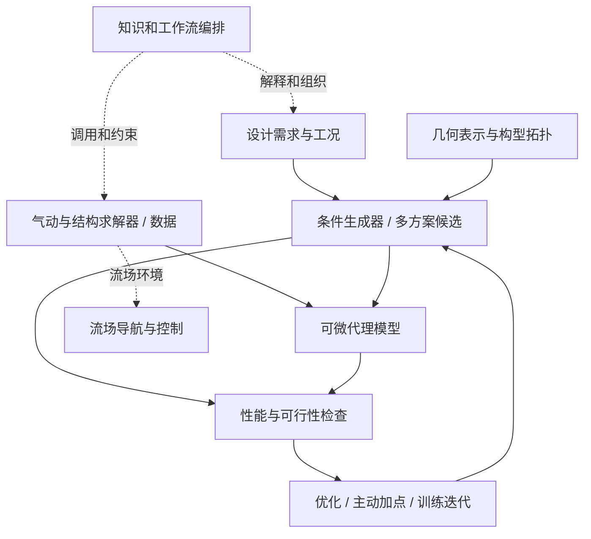

# 文献关系总览

> [!abstract] 阅读导航
> 本页是 Literature Vault 的 **Map of Content（MOC，内容地图）**：不是逐篇摘要的替代品，而是把已有论文组织成可跳转的研究问题、方法族与证据链。关系标注以仓库原有笔记为基础，并结合机翼生成器与气动代理模型的研究讨论。**论文确有方法承接**与**本文为设计决策建立的概念类比**被严格分开。

## 从研究问题进入

| 想解决的问题 | 专题入口 | 典型研究手段 |
| --- | --- | --- |
| 海量网格/点云怎样使用注意力、预测物理场？ | [[Literature/Topics/Transformer与物理场算子|Transformer 与物理场算子]] | 物理切片、局部-全局注意力、查询解码、条件调制 |
| 怎样用低维/变长的几何表示，满足给定性能并保持多解性？ | [[Literature/Topics/几何表示与性能条件生成|几何表示与性能条件生成]] | 潜变量、连续条件、DPP、扩散、CAD 序列 |
| 怎样利用有限的高质量 CFD 数据训练可靠的气动代理？ | [[Literature/Topics/气动代理与多保真学习|气动代理与多保真学习]] | Co-Kriging、多保真迁移、预训练、全局积分损失 |
| 如何在高维且高代价的设计空间搜索？ | [[Literature/Topics/气动优化与设计空间探索|气动优化与设计空间探索]] | 伴随梯度、降维、贝叶斯优化、保守约束、主动加点 |
| 智能体如何在未知或湍流环境中利用流场决策？ | [[Literature/Topics/流场导航与强化学习|流场导航与强化学习]] | 感知状态、奖励设计、经验回放、前视预测 |
| 怎样连接整机需求、求解器、设计助手与知识系统？ | [[Literature/Topics/整机设计与工程智能体|整机设计与工程智能体]] | 多学科建模、流程执行、规则增强检索 |
| 这些思想怎样映射到当前机翼生成器？ | [[Literature/Topics/机翼生成器研究对照与证据边界|机翼生成器研究对照]] | 分层表示、可微代理、约束训练、组件连接 |

## 一张图理解模型所在层级

图中是**面向当前研究任务的系统分层**，不是某一论文发表的完整统一架构，也不表示每篇文献直接继承相邻论文。

## 最重要的关系链

### A. 物理场注意力：全局聚合、局部修正与任意查询

- **明确架构承接**：[[Literature/transformer/Transolver|Transolver]] 的 Physics-Attention（物理注意力）→ [[Literature/transformer/Spatially-aware transformer operator for real-time aerodynamic evaluations of arbitrary three-dimensional vehicles|SATO]] 加入序列化局部注意力处理细节。
- **可比较方案，并非已证实的继承**：[[Literature/transformer/Perceiver IO|Perceiver IO]] 的 latent bottleneck（潜在瓶颈）+ output query（输出查询） ↔ [[Literature/transformer/SMART - Scalable Mesh-free Aerodynamic Simulations from Raw Geometries using a Transformer-based Surrogate Model|SMART]] 的几何 latent 与独立物理查询。
- **不同输入约束**：[[Literature/transformer/Towards a Foundation-Model Paradigm for Aerodynamic Prediction in Three-dimensional Design|AeroTransformer]] 面向统一结构化机翼表面网格及迁移学习，[[Literature/transformer/Transolver|Transolver]] / [[Literature/transformer/Spatially-aware transformer operator for real-time aerodynamic evaluations of arbitrary three-dimensional vehicles|SATO]] 面向不规则点云/网格，[[Literature/transformer/SMART - Scalable Mesh-free Aerodynamic Simulations from Raw Geometries using a Transformer-based Surrogate Model|SMART]] 强调从原始几何进行任意位置查询。不能仅按测试误差排序后互换。

### A2. Transolver 机制审视：attention 与全局混合不是一回事

- **机制重新审视（2026）**：[[Literature/transformer/Transolver Is a Linear Transformer Revisiting Physics-Attention Through the Lens of Linear Attention|LinearNO]] 与 [[Literature/transformer/Does Transolver really need a Transformer|Does Transolver really need a Transformer?]] 均显示 slice-token self-attention 可能并非主要性能来源；后者进一步强调每层 slice/deslice 的全局通信不能简单删除。两篇工作的归一化、基准和实验协议不同，需以各自内部消融为主，不直接横比绝对误差。

### B. 性能与多样性：从好设计，到指定目标下的多解

- **明确方法承接**：[[Literature/PaDGAN - A Generative Adversarial Network for Performance Augmented Diverse Designs|PaDGAN]] 的 performance-augmented Determinantal Point Process（DPP，行列式点过程）→ [[Literature/PcDGAN - A Continuous Conditional Diverse Generative Adversarial Network For Inverse Design|PcDGAN]] 的连续条件邻域训练与条件质量；详见 [[Literature/PaDGAN 与 PcDGAN：关系、差异与选择|专门对照]]。
- **替代生成路线**：[[Literature/DiffAirfoil An Efficient Novel Airfoil Sampler Based on Latent Space Diffusion Model for Aerodynamic Shape Optimization|DiffAirfoil]] 在学习到的几何潜空间扩散，可在去噪时施加条件引导；[[Literature/transformer/SkexGen - Autoregressive Generation of CAD Construction Sequences with Disentangled Codebooks|SkexGen]] 解耦 CAD（计算机辅助设计）拓扑/几何码本并自回归生成；[[Literature/A comparison of methodologies for generating design-requirement-driven conceptual aircraft designs|飞机概念生成方法比较]] 对比 VAE、flow、diffusion，但其主体实验不等于“需求硬约束条件生成”。

### C. 高保真标签昂贵：数据融合与误差守恒

- [[Literature/Generation of surrogate-based aerodynamic model of an UCAV configuration using an adaptive co-Kriging method|自适应 Co-Kriging]]、[[Literature/Multi-fidelity convolutional neural network surrogate model for aerodynamic optimization based on transfer learning|多保真 CNN + 迁移学习]]、[[Literature/Multi-fidelity aerodynamic data analysis by using composite neural network|复合神经网络]]均复用低/高保真信息，但**融合机制不相同**。
- [[Literature/transformer/Towards a Foundation-Model Paradigm for Aerodynamic Prediction in Three-dimensional Design|AeroTransformer]] 给出另一条二维/三维物理场预训练—下游微调路径，且引入流场到积分气动力的一致性损失。
- [[Literature/An ensemble weighted average conservative multi-fidelity surrogate modeling method for engineering optimization|保守多保真代理]] 关注约束误判与安全裕度：**拟合误差小 ≠ 最终可行性可靠**。

### D. 计算预算怎样分配

- [[Literature/Aerodynamic Design via Control Theory|Jameson 伴随优化]]：目标可微且流场方程可求导时的梯度路线。
- [[Literature/SURROOPT A GENERIC SURROGATE-BASED OPTIMIZATION CODE FOR AERODYNAMIC AND MULTIDISCIPLINARY DESIGN|SURROOPT]]：昂贵黑箱的代理—优化—采样闭环。
- [[Literature/Global aerodynamic design optimization based on data dimensionality reduction|POD 降维]]、[[Literature/Data-driven surrogate model for aerodynamic design using separable shape tensor method|Grassmann 几何参数化]]、[[Literature/High-dimensional efficient global optimization using both random and supervised embeddings|随机+监督嵌入]]：减少高维决策变量的搜索负担，但各自的可行域和优化机制不同。
- [[Literature/Toward Accelerating Discovery via Physics-Driven and Interactive Multifidelity Bayesian Optimization|物理驱动的多保真贝叶斯优化]]：面向有限预算，决定在哪里、用哪种保真度获得新信息。

### E. 控制与知识工程是两条旁支

- [[Literature/Learning to soar in turbulent environments|湍流翱翔仿真]]→[[Literature/Glider soaring via reinforcement learning in the field|野外翱翔验证]] 是同研究方向由仿真走向真实平台；[[Literature/Flow Navigation by Smart Microswimmers via Reinforcement Learning|微游动器]]、[[Literature/Learning efficient navigation in vortical flow fields|涡流导航]]、[[Literature/Efficient navigation in vortical flows based on reinforcement learning and flow field prediction|前视状态空间]]探索状态感知与环境预测的价值，不等于几何生成器。
- [[Literature/Aerodynamic Design and Optimization via a Specialized Agentic Generative AI Framework|Agentic MDAO 工作流]] 重在自动构造和执行优化；[[Literature/DR-RAG Domain-Rule-based Retrieval-Augmented Generation for aviation digital model design|DR-RAG]] 重在航空领域知识检索与规则约束，二者互补，而非相互替代。

## 怎样解释“关系”

| 关系标签 | 证据含义 | 示例 |
| --- | --- | --- |
| **方法承接** | 后作明确复用/扩展前作机制，或现有笔记准确记录这一点 | Transolver → SATO；PaDGAN → PcDGAN |
| **研究延展** | 同方向由仿真走向实测，或同问题进一步研究；不保证模型可直接迁移 | Reddy 2016 → Reddy 2018 |
| **方法比较** | 同任务但输入、输出、算子或训练机制不同 | Transolver ↔ SMART；POD ↔ Grassmann |
| **互补模块** | 可放入同一个设计流程但需独立验证接口/误差 | 气动代理 ↔ 保守约束 ↔ 生成器 |
| **项目假设** | 当前项目的可行架构建议，不是论文已经验证的结论 | CST 截面 token → 几何采样 → Transolver 预测 |

## 覆盖范围与边界

截至本次整理，仓库 `Literature/` 有 **39 篇独立论文笔记 + 2 篇已有综合笔记**，另有本次新增的主题地图。[[Literature/transformer/Transformer架构创新论文关联与项目设计参考|原 Transformer 专题综述]]包含一些尚无独立笔记的论文/架构，例如 PDE-Transformer、Swin Transformer 与离散自回归机构生成模型；本导航**不为缺失论文构造虚假的已有链接**，而是标注为阅读缺口。

> [!warning] 重要边界
> 笔记中的数值来自各自实验设置，输入几何、网格保真度、目标变量与数据集并不相同。**不要直接横向比较不同论文的误差或运行时间得出优劣排名。** 项目建议部分标记为推论，需要消融、误差传播与工程基线验证。
